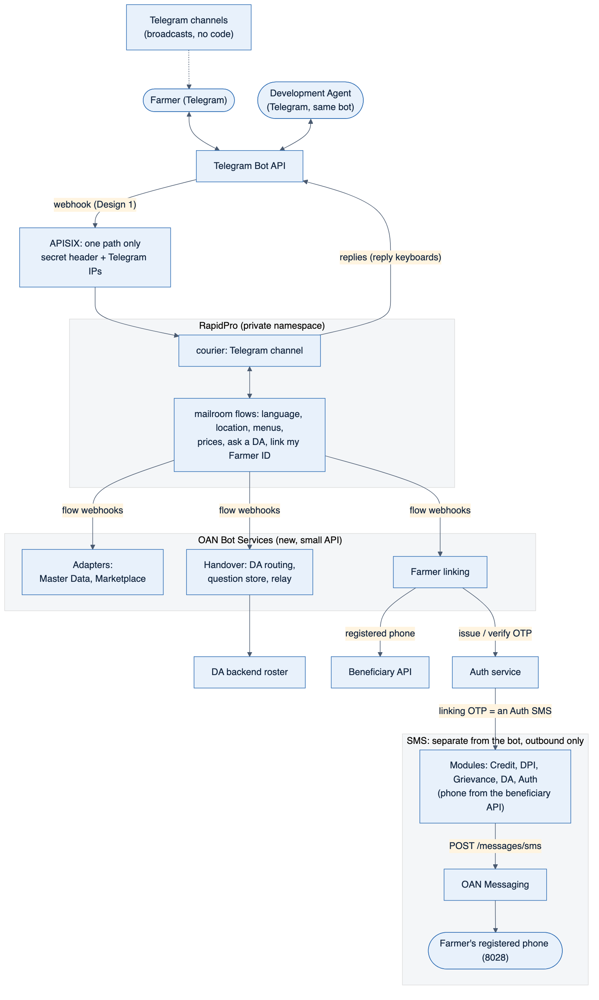
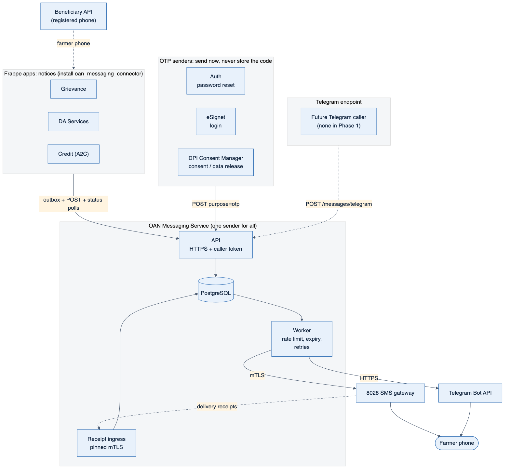

# 2 Architecture

## 2.1 The whole picture

| Component | Owns | Channel |
|---|---|---|
| **OAN Messaging Service** | The only SMS sender: API, PostgreSQL store, workers, 8028 adapter, delivery-receipt listener, cleanup. Also has a Telegram send endpoint, with no caller in Phase 1. | SMS |
| **Module services** (Credit, DPI Consent Manager, Grievance, DA Services, Auth, eSignet) | Deciding when to send, the text, the recipient's registered phone, and their own record of each message | SMS |
| **Frappe connector** (`oan_messaging_connector`) | A shared Frappe app that gives every Frappe module an outbox, safe retries and status polling | SMS |
| **Beneficiary API** (farmer registry) | The farmer's registered phone | Both |
| **RapidPro** (courier, mailroom, web) | Receiving Telegram through the webhook, contacts, flows (language, notice, location, menus, prices, question intake, linking), sending replies, the Stop flow | Telegram |
| **OAN Bot Services** (new, small API with its own PostgreSQL) | Adapters to Master Data, Marketplace and the DA backend; Development Agent routing, relay and reminders; question store; Development Agent linking; farmer linking; area broadcasts for the DA web app; weekly figures for Reports Central | Telegram |
| **Garage** (S3-compatible object storage) | Media for RapidPro, with one GET-only public route for media sent to Telegram (§5.9) | Telegram |
| **Reports Central** | The weekly DA report, emailed by scope (§6.4.4) | Telegram |
| **Auth service** | Issues and verifies the farmer-linking OTP; sends it as an ordinary OTP SMS | SMS |
| **API gateway (APISIX)** | The single public Telegram webhook path and its controls (Design 1) | Telegram |
| **Telegram channels** | Broadcasts by DA Communications Officers (no code); targeted area broadcasts go through the bot (§6.8) | Telegram |

## 2.2 SMS flow

1. A module decides to notify someone and takes the recipient's phone from its source
   of truth (for farmers, the beneficiary API).
2. It stores its own record of the intended message with a random UUID4 key, then calls
   `POST /api/v1/messages/sms` after its own transaction commits.
3. OAN validates, stores and answers `202`. A worker sends to 8028 later, within the
   rate limit and before the message's expiry.
4. 8028 reports delivery to OAN's receipt listener; the module polls
   `GET /api/v1/messages/{id}` for the outcome.

## 2.3 Telegram flow

1. Telegram calls the one public webhook path. APISIX checks the secret header and the
   source address, then passes the update to RapidPro's courier.
2. A RapidPro flow handles the step (menus, language, location). When it needs data or
   an action, it calls OAN Bot Services through a webhook node.
3. OAN Bot Services calls the owning OAN service (Master Data, Marketplace, DA backend,
   beneficiary API, Auth) and returns plain JSON.
4. Replies go back through RapidPro to Telegram. Questions to Development Agents are
   sent by OAN Bot Services through the RapidPro API.

## 2.4 Identities and phone numbers

| Identifier | What it is | Where it may appear |
|---|---|---|
| Registered phone | The farmer's phone in the farmer registry | Beneficiary API, the sending module, OAN Messaging (encrypted, purged after sending) |
| Alternate Telegram number | The number on the farmer's own Telegram account, approved by an OTP to the registered phone | OAN Bot Services link record only. Never in the registry, never used for SMS, never logged. |
| Farmer ID | The registry identifier | Beneficiary API, OAN Bot Services link record and subscription row. In RapidPro only inside messages shown to Development Agents (RP-D4) and in short-lived webhook logs (§5.4); never as a contact field. |
| `chat_id` | Telegram chat identifier, needed to reply | RapidPro contact (as its URN) |
| `contact_ref` | HMAC-SHA256 of `chat_id` with a secret key | Logs, metrics, audit events, the question store and calls to OAN services |
| `da_ref` | Development Agent reference from the DA backend | Question store, routing state |
| OAN message `id` | OAN's id for one accepted message | The sender's own record; used to poll |

## 2.5 Trust boundaries

* **Public:** the Telegram webhook path (Design 1); the GET-only media route that
  Telegram fetches relayed media from (§5.9); and, for 8028, the receipt listener behind
  pinned mutual TLS.
* **Internal, authenticated:** module services to OAN Messaging (bearer token per caller,
  HTTPS with strict certificate checks); RapidPro flows to OAN Bot Services (service
  credential); OAN Bot Services to OAN services (Keycloak service account).
* **Staff only:** RapidPro web and API (VPN and SSO); OAN Messaging operator commands
  (cluster access).
