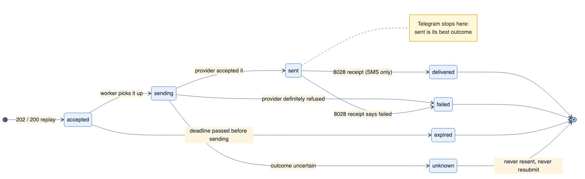

# 3 SMS channel: the OAN Messaging Service

The OAN Messaging Service accepts send requests from OAN services, stores them durably,
sends them from background workers through the 8028 SMS gateway, and reports honest
outcomes. It does **not** generate or check OTPs, validate identities, receive SMS, run
conversations or decide who should receive what.

The frozen interfaces are `docs/openapi.yaml` (HTTP, contract 3.1.0) and
`oan_messaging/contracts.py` (Python). 8028 specifics are in `docs/8028-contract.md`.

## 3.1 API

Every call needs `Authorization: Bearer <caller token>`. Each module is its own caller,
with its own token, allowed channels and allowed purposes.

| Endpoint | Success | Notes |
|---|---|---|
| `POST /api/v1/messages/sms` | `202` new; `200` identical replay | `Idempotency-Key` header; one Ethiopian mobile; one SMS part |
| `POST /api/v1/messages/telegram` | `202` new; `200` identical replay | No caller in Phase 1 (§1.3) |
| `GET /api/v1/messages/{id}` | `200` | `404` for unknown ids **and** for other callers' ids |

Errors are `application/problem+json`: a top-level `code` (`unauthenticated`, `forbidden`,
`not_found`, `validation_failed`, `idempotency_conflict`, `payload_too_large`,
`unsupported_media_type`, `service_unavailable`) and, for validation, an `errors` list of
`{field, code}` (for example `{field: text, code: too_long_for_single_sms}`). Submitted
values are never echoed. The API returns no `429` and no `Retry-After`; a gateway in front
of it may. Unknown fields are rejected, so a request can never carry a token,
provider URL or priority.

### SMS request fields

| Field | Rule |
|---|---|
| `Idempotency-Key` (header) | 8–128 characters of `[A-Za-z0-9._:-]`, starting with a letter or digit. One per intended message: a random UUID4 stored with the caller's record, or, for a sender with no outbox (OTP senders), the deterministic `delivery_key` UUID5 from the client library. Never contains personal data. |
| `recipient` | `09XXXXXXXX`, `07XXXXXXXX`, `2519…`, `+2519…` or `+2517…`; stored as E.164 |
| `text` | Not blank; no control characters except line breaks. **Up to 3 SMS parts (SMS-09):** one part is 160 GSM-7 characters, or 70 if the text contains any character outside GSM-7 (any Amharic letter, curly quote, en dash or emoji); a longer text is sent as one concatenated message at 153 / 67 per part, so at most 459 / 201, and a two-unit character is never split between parts. **An `otp` text must fit one part** (`422`, error `too_long_for_single_sms`). Longer text is refused (`422`, error `too_long_for_sms`), never cut. |
| `source_reference` | 1–128 characters of `[A-Za-z0-9._:-]`, starting with a letter or digit. Names the business event (for example `grievance:G-1042:deadline_extended`). Not unique. Never contains personal data. |
| `purpose` | `otp`, `transactional`, `alert` or `broadcast` (`broadcast` is accepted when `OAN_MSG_BROADCAST_ENABLED` is on). The caller must be allowed it. |
| `expires_at` | RFC 3339 with an offset. **Required for `otp`**, at most 30 minutes ahead. Other purposes: optional, at most 7 days ahead. OAN never extends or rewrites it. |

## 3.2 Idempotency: retries never become second messages

* The key is scoped to (caller, channel). The first request with a key creates the
  message (`202`). The **same key with the same body** returns the original (`200`),
  however old, while the binding lasts. The same key with a **different body** is
  `409 idempotency_conflict`.
* Bindings of messages still in progress (`accepted`, `sending`, `unknown`) are never
  released. Bindings of completed messages are kept at least 30 days.
* Comparison uses a keyed HMAC-SHA256 fingerprint of the canonical body, so it still
  works after the text has been purged.
* A **retry** (after a timeout, `503` or other `5xx`, a gateway `429`, or a dropped connection) reuses the key and
  body. A **resend** (a new message someone asked for) uses a new key. An `unknown`
  message is never resent, under any key.

## 3.3 Message lifecycle

| Status | Evidence | Final | Show users |
|---|---|---|---|
| `accepted` | committed row | no | In progress |
| `sending` | attempt committed before the network call | no | In progress |
| `sent` | 8028 returned a message id (`sms_id`) | no (waits for a receipt) | Sent |
| `delivered` | authenticated 8028 `Delivered` receipt matched on `sms_id` **and** recipient | yes | Delivered |
| `failed` | definite refusal, or a final negative receipt (`Rejected`, `Expired`) | yes | Not delivered |
| `expired` | `expires_at` passed before any attempt | yes | Not sent in time |
| `unknown` | an attempt began but its outcome cannot be proven | stop polling | Uncertain; a person checks |

## 3.4 Sending

* **Workers** claim due messages with `FOR UPDATE SKIP LOCKED`, one at a time by
  default, in priority order (`otp` before `transactional` before `alert` before
  `broadcast`). Each worker claims only the channels it can send.
* **Broadcast ageing (SMS-03 fix, decided 19 Nov 2026):** a `broadcast` message that has
  waited longer than `broadcast_max_wait` (configuration, proposed default 180 seconds) is
  claimed ahead of newer non-OTP traffic, so sustained higher-priority load can delay a
  broadcast but never starve it. The OTP reserve is unchanged; there is no reserved share
  for broadcasts. **Built 20 Nov 2026** (contract 3.1.0 service, migration 0004): OTPs first,
  then every message waiting longer than `broadcast_max_wait` oldest first whatever its
  purpose (an older alert keeps its place), then the rest by priority; the starvation test
  passes. Turned on with `OAN_MSG_BROADCAST_ENABLED`. A large campaign delays newer
  transactional and alert SMS until it drains (user's choice, 20 Nov 2026).
* **Batching (decided 19 Nov 2026):** queued messages with exactly the same text are sent
  in one 8028 request of up to `batch_max_recipients` numbers (configuration, default
  **100**). Each recipient stays its own message (own key, status and receipt); the
  `sms_id`s in the response are matched back in order. 8028 requests are all or nothing,
  so a batch that may have left without a response makes every message in it `unknown`,
  never resent. OTPs and personal notices are sent one per request.
* **Expiry** is checked again immediately before each network call.
* **Pacing (SMS-10, 20 Nov 2026):** 8028 has no API rate limit and queues everything, but
  the operator sends only 2–5 SMS a second. Anything sent faster waits in 8028's queue,
  where our order (OTP first, broadcast ageing) no longer applies. So OAN paces 8028 at
  **4 SMS a second** (`OAN_MSG_SMS_RATE_PER_SECOND`), one slot of each second kept for OTP
  (`OAN_MSG_SMS_OTP_RESERVE`), counted per SMS (a batch counts each number). The worker
  reserves a slot inside the same database transaction that records the attempt (a
  transaction-scoped advisory lock), so the pace holds across workers. A 1 million SMS
  campaign takes about 3 days at this pace.
* **Before the call**, the attempt is committed. After it, the result is recorded:
  `sent`, `failed`, back to `accepted` with a back-off if the message provably never
  left (connection refused, TLS failure, or an HTTP 500, which 8028 confirmed queues
  nothing: SMS-11), or `unknown` if it might have left (any other 5xx, a timeout).
* **8028 connection:** mutual TLS with a client certificate, the 8028 CA bundle and
  hostname checks; numbers are converted to the domestic `09…`/`07…` form.

## 3.5 Receipts, retention and privacy

* **Receipts** (8028 guide v1.1): 8028 calls the receipt listener at the registered path
  (`/sms-status-receiver/v1/update-status`). Two factors are checked in the process:
  mutual TLS with a certificate issued by 8028's callback CA (optionally narrowed by
  pinned certificates; never a certificate header from a proxy), and the callback secret
  in the body (never stored or logged). The listener stores the receipt, then answers
  `200 {"success": true}`. Receipts are matched on `sms_id` and a fingerprint of the
  recipient (sent as `251…`) within 7 days of sending.

  The three 8028 documents named the field differently; **8028 confirmed `status`**
  with `Pending`, `Delivered`, `Rejected` (20 Nov 2026, SMS-07). The listener reads
  `status` only. Callbacks come from 213.55.73.209, which the listener's network policy
  allows.

  | 8028 value | OAN status |
  |---|---|
  | `Pending`, `Sent` | `sent` (never overwrites a final status) |
  | `Delivered` | `delivered` |
  | `Rejected`, `Failed` | `failed` (`provider_rejected`) |
  | `Expired` | `failed` (`provider_delivery_expired`) |
  | anything else, including null | recorded, no change |

* **Content** (text and recipient) is encrypted at rest and deleted in the same
  transaction that moves a message out of `accepted`/`sending`, including `sent`. A
  sweeper removes anything left within about 7 minutes while workers and the database
  are up. After that, only metadata remains: ids, key, `source_reference`, status,
  masked recipient, timestamps and fingerprints.
* **Raw receipt phone numbers are never stored**; only a fingerprint and a masked number.
* Receipt evidence is kept 90 days; all retention periods are configurable defaults,
  not an approved production policy.

## 3.6 Reliability and operations

| Situation | Behaviour |
|---|---|
| 8028 refuses the credential or TLS configuration | The SMS channel is **suspended**: messages wait, an alert fires, an operator fixes it and runs `resume`. The backlog is not failed. |
| Repeated uncertain outcomes, or 8028 asks to slow down | A cooldown (60 seconds, or the provider's `retry_after`) |
| A row cannot be decrypted (for example a missing key version) | The row is deferred and kept; an alert fires; other messages continue |
| Database error in the worker loop | The worker recovers and continues |
| A worker dies mid-call | After its lease (2 minutes) the message becomes `unknown`, never resent |
| Start-up | Workers refuse to start if database latency is too high for the rate limit, if a key version used by stored data is missing, or if an enabled Telegram caller's bot has no token |

**Deployment:** one container image (non-root, read-only file system) runs four
processes: `api`, `worker`, `receipts` and `cleanup`. The Helm chart runs migrations as
a pre-install/pre-upgrade job under a database **owner** role; everything else runs under
a **runtime** role with only the grants in `deploy/sql/grants.sql`.

**Health and alerts:** the API has `/livez` and `/readyz`; the worker writes a heartbeat
checked by its liveness probe. A `status-check` CronJob runs `status --fail-on-alert`
and fails on any of: old queue, messages stuck in `sending`, `unknown` outcomes, late
starts, deferred rows, receipt anomalies or a suspended channel.

**Statistics (SMS-12, 20 November 2026):** `GET /api/v1/charts/{chartId}` and
`GET /api/v1/charts?charts=…` serve the dashboard contract of the other OAN services (A2C,
Grievance), so Reports Central reads OAN Messaging as one more upstream. Only a read-only
statistics reader (`caller --stats-reader`, its own OAN token; it cannot send) may call
them. Counts only: totals by status, delivered and failed shares, send and delivery time
(median, p95), by module, purpose and day/week/month; failure reasons; OTP speed;
broadcast campaigns; and, live, the queue and each channel's health. The cleanup component
rebuilds the snapshot every 15 minutes; `meta.as_of` says when.

**Operator commands** (runbook: `docs/runbook.md`): `caller` (register a caller, its
channels and purposes), `issue-credential` (token shown once), `list-credentials`,
`revoke-credentials --credential ID | --all`, `suspend`, `resume`, `status`,
`cleanup`.

**Pilot limits:** `broadcast` disabled until broadcast ageing is built and tested; no
Telegram caller; receipts need 8028's
callback configuration and certificates.
