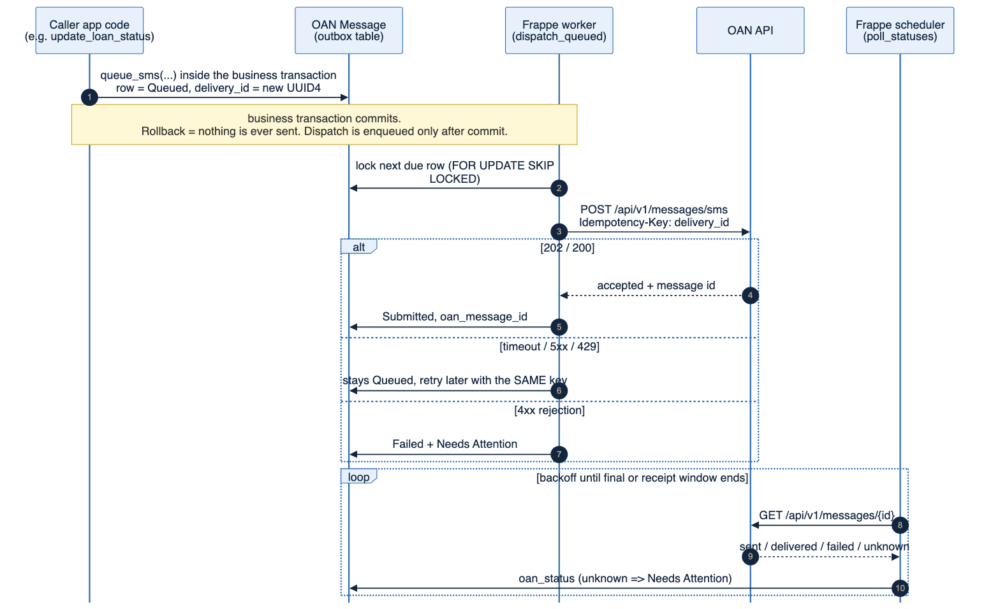
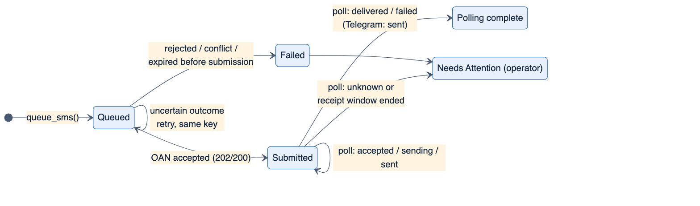
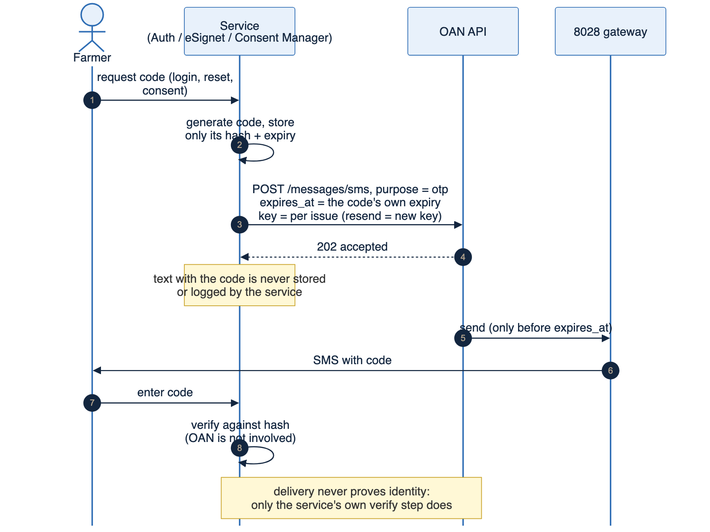

# 4 SMS channel: callers and the Frappe connector

This chapter sets the rules every SMS sender follows. The step-by-step work for each
team is in the *OAN Messaging integration handoff* pack.

## 4.1 Three ways to send

| Pattern | Who | Why |
|---|---|---|
| **Frappe connector** (`oan_messaging_connector`) | Grievance, DA Services, Credit (A2C) | Notices must survive restarts and outages. The connector keeps an outbox row per message with a fixed key, sends after the business transaction commits, retries safely and polls the status. |
| **OTP sender** (send now) | Auth, eSignet, DPI Consent Manager | A code must never be stored or logged in plain text and is worthless after minutes. The service sends immediately with `purpose = otp` and the code's own expiry. |
| **Direct API** | Any other non-Frappe sender | The Python client or plain HTTPS against the contract, with the sender's own record of each message (key and OAN id) |

**Interim, for existing Frappe senders only.** Grievance and Auth already send through
Frappe's built-in SMS sender. The connector also provides a Frappe `send_sms` hook that a
module can switch on with one line in its `hooks.py`, so that sender goes to OAN before
the module changes its code. It is supported but not preferred: it gets no delivery
status, applies one purpose and expiry to every SMS on the site, and its unclear outcomes
can lead to a duplicate if the caller sends again. It raises on every failure, so the
modules' own fail-closed handling still works. Explicit calls (the connector's
`queue_sms` or the OTP sender) remain the target for every module. Details: handoff
guide 03 §7.

## 4.2 Callers

| Caller | Pattern | Purposes | What it sends | Status |
|---|---|---|---|---|
| `a2c` | Connector | transactional | Application submitted, stage changes, approval, rejection, disbursal, agent visits (8 events) | Kit built; tested end to end |
| `dpi-consent` | OTP sender | otp, transactional | Consent and data-release OTPs; consent notices later | Kit built; tested end to end |
| `grievance` | Connector | transactional (+ otp for Auth) | 12 grievance notices (received, updates, closure) | Kit built and tested |
| `da` | Connector | transactional (+ otp for Auth) | Visit planned and rescheduled, to the farmer when the agent ticks the box (agents are alerted on Telegram) | Kit built and tested |
| `da` (Broadcast screen) | Connector | alert, broadcast | The SMS copy of DA web app broadcasts (§6.8.3): `Emergency` and `Weather` as `alert`, `Knowledge` and `Informational` as `broadcast`, one message per farmer with a phone except those reached on Telegram; also the welcome SMS (§6.1) | Designed; `broadcast` waits for the SMS-03 fix |
| The caller of the site Auth runs on | OTP sender (`send_sms_now`) | otp | Password-reset OTP (kit built, tested end to end); Telegram linking OTP (§6.6, designed) | Kit built and tested |
| `esignet` | OTP sender | otp | Login OTP for Farmer ID | Java sender built and tested; the eSignet team wires it in |

The OAN operator registers each caller, its channels and purposes, and issues its token
(shown once). Tokens go straight into the caller's secret store.

## 4.3 Rules every sender follows

1. **One key per intended message**, created once and reused on every retry. With an
   outbox: a random UUID4 stored on the row. Without one (OTP senders): the
   deterministic `delivery_key(service, event_id, role, channel)` UUID5 from the client
   library, with a new event id for every new code. Never built from a name that can
   restart or from personal data.
2. **A retry is not a resend.** Retry an uncertain outcome with the same key and body. A
   new message someone asked for gets a new key.
3. **Never resubmit `unknown`.** Flag it for a person.
4. **`202` means accepted, not sent.** Show "Submitted" until the status changes.
5. **Count the parts.** OAN accepts up to 3 parts (SMS-09) and an OTP in one part. Keep
   notices to one part where you can (each part is charged): measure every template in every
   language with the longest real values, 160 characters or 70 with any Amharic character.
6. **Expiry is yours.** Compute it once from the business deadline (the OTP's expiry, the
   visit time capped below 7 days ahead), store it, reuse it on retries.
7. **`source_reference`** names the business event, never a person.
8. **Poll, don't wait.** Back off from 1 minute to 6 hours; stop at a final status, at
   `unknown` (and flag it), or 7 days after sending.
9. **Phone from the source of truth.** Farmers: the registered phone from the beneficiary
   API. Never a number typed into Telegram.
10. **Nothing personal in logs:** no token, text or full number.

| Response | Do |
|---|---|
| `202` / `200` | Store the OAN `id`; mark Submitted; start polling |
| `409 idempotency_conflict` | A bug: the text or recipient changed under one key. Mark Failed and alert. |
| `422 validation_failed` | `errors[].code` says why: bad number, too long, expired, OTP without expiry. Mark Failed; do not retry unchanged. |
| `401 unauthenticated` / `403 forbidden` | Token wrong, or channel or purpose not permitted (`purpose_not_permitted`). Alert the operator; do not loop. |
| `503`, a gateway `429` or `5xx`, timeout, connection error | Uncertain. Retry later with back-off, the same key and the same body (and no sooner than a gateway's `Retry-After`, if any). |

## 4.4 The Frappe connector

| Part | Purpose |
|---|---|
| **OAN Message** doctype | The outbox: one row per intended message. `delivery_id` (UUID4, set at insert) is the idempotency key and never changes. Rows cannot be deleted. |
| **OAN Messaging Settings** | Enabled, base URL, caller token, CA bundle, HTTP attempts, receipt window, content retention (days). `site_config.json` keys override them: `oan_messaging_enabled`, `oan_messaging_base_url`, `oan_messaging_token`, `oan_messaging_ca_bundle`. |
| `queue_sms(...)` | The only call a module makes, inside its business transaction. It only inserts a row and **never raises**: if disabled, invalid, or settings, the database or the queue fail, it returns `None` and writes an Error Log. **It refuses OTPs**, because the outbox stores the text. |
| `dispatch_queued` | Runs after commit, and every minute as a safety net; `FOR UPDATE SKIP LOCKED`, one commit per row |
| `poll_statuses` | Every minute for due rows (back-off 1 minute to 6 hours); never resends; SMS polling stops after the receipt window |
| Length check | `sms.sms_parts()` counts parts as OAN does; `queue_sms` refuses more than 3 parts, `send_sms_now` (OTPs) more than one |
| `purge_content` | Daily: on finished rows older than the retention period (default 7 days), clears the text and masks the recipient; delivery metadata stays |

Desk states: **Queued**, **Submitted** (with the OAN status), **Failed**, and the
**Needs Attention** flag (failed rows, `unknown`, or polling ended without a final
status).

**Requirements:** HTTPS base URL (the client refuses anything else); on Frappe v16
(Python 3.14) a private CA's certificates must carry Subject and Authority Key
Identifiers and CA key usage; the scheduler and workers (including the `short` queue, which runs dispatch) on every site.

**Known limits:** SMS only; no send-now helper for OTPs yet (OTP senders use §4.5).

## 4.5 OTP senders

1. The service generates the code and stores only its hash and expiry.
2. It sends immediately: `purpose = otp`, `expires_at` = the code's own expiry (at most
   30 minutes).
3. Every new code, including a resend the user asked for, gets a new key. An uncertain
   POST is retried with the same key and body.
4. The text lives only in memory or job arguments; the code is masked in every log line.
5. If the code cannot be handed to OAN, the service says so and the user asks again. No
   automatic new code.
6. Verification stays in the issuing service. Delivery proves nothing about identity.

## 4.6 Phone numbers

* **Farmers:** the registered phone from the beneficiary API. The lookup for the
  Consent Manager OTP and the Telegram linking OTP is an open decision for the identity
  owner and DPI (§8.3).
* **Development Agents and staff:** from the owning system (DA backend roster, user
  accounts).
* **eSignet:** the phone linked to the Farmer ID in eSignet.
* OAN accepts only Ethiopian mobile numbers; senders may pre-check before issuing an OTP.
