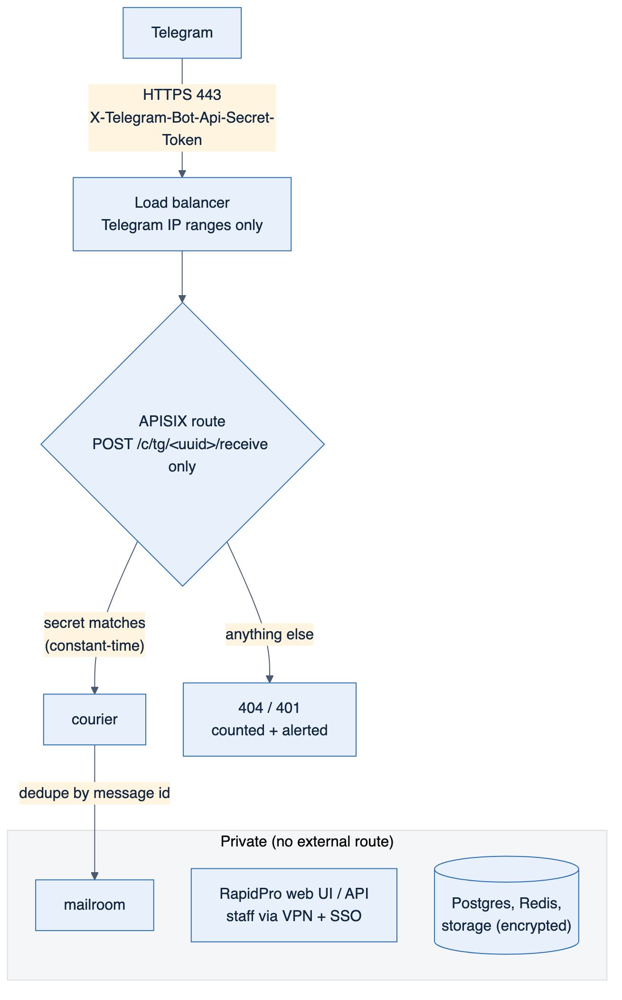

# 5 Telegram channel: platform, security and shared rules

## 5.1 Platform: RapidPro plus OAN Bot Services

RapidPro (UNICEF's open-source messaging platform: courier, mailroom and web) receives
Telegram updates, keeps contacts and runs the conversation flows. It lets non-developers
edit menus and texts. It cannot do the OAN-specific parts, so a small service, **OAN
Bot Services**, does them and RapidPro flows call it.

| RapidPro does | OAN Bot Services does |
|---|---|
| Receive updates through the webhook (Design 1) | Adapters to Master Data, Marketplace, the DA backend, the beneficiary API and Auth, behind one Keycloak service account |
| Contacts, language, the current step, flow timeouts | Development Agent routing (specialism, kebele inbox claim, availability and officer cover) |
| Flows: language, privacy notice, location menus, Main menu (with Updates on/off), prices, question intake, farmer linking, Stop, and one thin staff flow | Question store, relay between farmer and Development Agent, reminders, area broadcasts (§6.8), weekly figures for Reports Central (§6.4.4) |
| Every farmer and staff text, as flow translations | Development Agent linking; farmer linking; deciding what to send to whom |
| Send replies within Telegram's limits; stop a contact that blocked the bot | Sending to other contacts through the RapidPro API (§5.8) |

**Flow ↔ service contract:** plain JSON over HTTPS (§5.8). Flows never call Master Data,
Marketplace, the beneficiary API, Auth or OAN Messaging directly, so the service is the
single, auditable adapter layer. Each call has a contract test.

**What changes for users because of RapidPro** (decided 19 Nov 2026, §8.2):

| Topic | Effect | Decision |
|---|---|---|
| Data held | RapidPro keeps a contact per person (Telegram id and name), message history and downloaded media; staff chats hold copies of relayed questions | RP-D1: accepted. Database and media storage encrypted at rest; RapidPro web and API for operators only; retention configurable, **90 days by default**, for messages and media; media in Garage (§5.9); Stop deletes the contact, its staff-side copies and its media (§5.4). Each deletion is verified on the deployed version before release. |
| Buttons | Menus are **reply-keyboard** buttons that send their label as a message. Inline buttons (`callback_query`) are not received. Messages cannot be edited, so old buttons stay on screen and Bot Services refuses stale taps politely. | RP-D2: accepted; courier is not patched |
| Media to Development Agents | Sent as attachments, not forwards. The header shows the farmer's **registered name and Farmer ID** for a linked farmer (read from the beneficiary API at delivery time, not stored), or the **Telegram first name, marked "not verified"**, for an unlinked farmer. | RP-D4: accepted |
| Operations | RapidPro is a larger platform (web, mailroom, courier, PostgreSQL, Valkey or Redis, Elasticsearch or OpenSearch, object storage) | RP-D6: **ATI DevOps** runs it self-hosted in the OAN cluster; the delivery team supplies Helm values, the pinned version, the backup and restore runbook (PostgreSQL and Garage, restore tested) and an upgrade checklist; contract tests are re-run before every upgrade |

The custom router in Appendix A remains the fallback if RapidPro is later rejected; every
module rule in chapter 6 applies to both.

## 5.2 Verified RapidPro behaviour

Checked in courier `v26.3.82` and goflow source:

* Telegram is received only through an HTTP POST `receive` route: a webhook is required;
  long polling is not supported.
* Courier does **not** check Telegram's `X-Telegram-Bot-Api-Secret-Token` header; the
  gateway must (§5.3).
* Quick replies become reply keyboards; inline keyboards are URL links only.
* "Bot was blocked by the user" or "user is deactivated" stops the contact.
* Incoming photo, video, audio, voice, document, location and contact messages are
  handled; files are downloaded into RapidPro storage.
* Incoming messages are deduplicated by Telegram message id (changelog; not seen in
  code).
* A flow webhook node evaluates header values as templates; a ticket's assignee is a
  fixed user, so dynamic routing cannot be done in flows.
* **Sending media to Telegram passes the attachment URL** (`sendPhoto` with
  `photo=<URL>`, and the same for video, audio and documents); Telegram's servers fetch
  it. Media sent from the bot must therefore be reachable from the internet (§5.9).
* Object storage (checked on `main`, 17 Nov 2026): courier and mailroom take
  `S3Endpoint`, `S3PathStyle` and bucket names and read credentials from the AWS SDK for
  Go v2 default chain; the web app uses the Django S3 storage backend with path-style
  addressing. Its "public" storage uploads with the `public-read` ACL.

**Not verified** (deployed version unknown): whether the web app registers the webhook
with a secret token; `/start` deep-link handling; courier's 429 back-off and reply
priority; message and media retention settings; RapidPro API rate limits; whether
courier passes Telegram's own file URL (which contains the bot token) when relaying
media; webhook log retention; deleting single messages through the API; how a flow
start treats a contact already in a flow. These form the RapidPro release gate (§7.6,
RV-01).

## 5.3 Design 1: securing the webhook

| Control | Setting |
|---|---|
| One route only | `POST /c/tg/<channel-uuid>/receive` on a dedicated host; everything else returns 404 |
| Secret header | Register with `setWebhook … secret_token=<64 random characters>`. APISIX compares `X-Telegram-Bot-Api-Secret-Token` in constant time and drops a mismatch. |
| Source addresses | Accept only Telegram's webhook ranges (`149.154.160.0/20`, `91.108.4.0/22`); defence in depth, because the ranges can change |
| TLS | Public certificate, TLS 1.2 or later, port 443 |
| Limits | Body at most 1 MB; rate limit per source; short timeout; webhook `max_connections` about 20; `allowed_updates: [message]` |
| Isolation | Courier ingress only from the gateway. Courier egress only to `api.telegram.org:443` and RapidPro internals. RapidPro web and API only for staff (VPN and SSO). Mailroom has no external route. |
| Secrets | Bot token per environment in courier's channel configuration (database encrypted, access restricted); webhook secret in a Kubernetes Secret; rotation runbook |
| Monitoring | Gateway counts of rejected calls (alert on spikes); scheduled `getWebhookInfo` (`last_error_message`, `pending_update_count`) |
| Registration | If RapidPro registers the webhook without the secret, DevOps re-registers it with the secret after the channel is added, and checks it after every channel change |

## 5.4 Conversation rules (every module)

* **State machine.** Each step is a flow step; buttons are reply-keyboard buttons. An
  unexpected reply shows the same menu again with "Please choose one of the options
  below."
* **Global commands:** `/start`, `/stop`, Main menu, Change language and Back work from
  every step.
* **Session:** a step expires after 30 minutes of silence; the farmer returns to Main
  menu.
* **What the bot keeps** (shown in the privacy notice after the first language choice):
  * in RapidPro: the farmer's contact (Telegram id and name), language, kebele, and the
    conversation, including downloaded photos and voice notes, for the configured
    retention period (90 days by default);
  * in OAN Bot Services: question records (with `contact_ref` only) for 90 days after
    closing; and, only after linking, the Farmer ID, linked phone and a subscription
    record with updates on or off (§6.8.1).

  The notice says that linked farmers receive official updates for their area and can
  turn them off in Main menu, and that messages pass through RapidPro's webhook logs,
  which are kept for a short configured period (3 days by default) and then expire.

  The notice also says that a Development Agent who receives a question sees the
  farmer's name (registered name if linked, otherwise Telegram name) and the photos and
  voice notes sent, and that what is already in a Development Agent's Telegram app cannot
  be removed by the bot. The bot asks for the Farmer ID and phone number only if the
  farmer chooses to link. The notice must state the configured retention
  period and must not promise more than the platform does.
* **Stop:** Main menu has "Stop and delete my data"; `/stop` does the same. After
  confirmation, the flow calls OAN Bot Services, which:
  1. deletes the farmer link and the subscription record and drops queued messages;
  2. closes open questions with the reason "farmer stopped" (their records keep only
     `contact_ref` until normal retention);
  3. deletes the copies of that farmer's questions and relayed messages from the
     Development Agents' and officers' RapidPro histories, using the message references
     it holds (`handover_messages`), **if RV-01 shows RapidPro can delete them**;
  4. deletes the farmer's media files in Garage;
  5. deletes the RapidPro contact through the RapidPro API, which removes its message
     history.

  Each deletion must be verified on the deployed RapidPro version before the Stop flow is
  published (RP-D1 release gate). The privacy notice promises only the deletions that
  pass; RapidPro's search index, webhook logs and backups follow their own retention
  and are stated as such. Messages already shown in a Development Agent's
  Telegram app stay there. A later `/start` begins as a new contact.
* **Webhook payloads may carry message content** (TG decision, §8.2): the question text
  in `/questions`, staff replies in `/staff/inbound` and the Farmer ID in `notify`
  parameters. RapidPro keeps webhook requests and responses in its HTTP logs, so:
  * HTTP log retention is short and configurable (**3 days** by default), verified in
    RV-01;
  * only a small named group can edit flows or read logs (they can see the content);
  * Stop relies on that expiry for log copies; it does not delete them.
* **`contact_ref`** (HMAC-SHA256 of `chat_id` with a secret key) is the only farmer
  identifier allowed in logs, metrics, audit events, the question store and calls to
  OAN services, except the Farmer ID and phone sent to the beneficiary API and Auth
  during linking.
* **Sending limits** (Telegram Bot FAQ): about 1 message a second to one chat and 30 a
  second overall; replies to a farmer's action before reminders; on HTTP 429 pause for
  `retry_after`; a blocked or deactivated user stops the contact.

## 5.5 Texts and languages

* Every farmer-facing and staff-facing string lives in one catalogue keyed by id (for
  example `price.card`, `ask.ack`, `staff.claimed_by`), with English and Amharic values.
  With RapidPro the catalogue becomes flow translations; no strings in code. OAN Bot
  Services returns **text keys and parameters**, never sentences (§5.8).
* A new key is published in the flow before the Bot Services release that emits it; a
  contract test fails if Bot Services can emit a key the flows do not have. Rewording
  an existing text needs no release.
* The source is the OAN Telegram Bot copy and translation sheet. New strings are
  translated with the existing Google Sheet workflow and reviewed by a native Amharic
  speaker before release.
* Buttons hold at most about 30 characters; keep labels short in both languages.
* Languages are configuration: each contact's language is an ISO 639 code (`am`, `en`,
  later `om` for Afaan Oromoo).

## 5.6 Location and Master Data

* Region › zone › woreda › kebele, from Master Data (Development:
  `master-data.development.oanstaging.com`), cached 24 hours. Up to 8 buttons a page
  with Next page and Back. The chosen kebele is saved and offered again ("Use Kebele
  X?").
* Access through the bot's Keycloak service account with a read-only role on
  administrative areas.
* On failure, serve the last cached copy and log a warning.
* The **kebele code** from Master Data is the key used everywhere: QR codes, the DA
  backend roster and question records. Routing on it, and what the DA backend must hold,
  is in §6.4.

| Call | Request | Response fields (placeholders to confirm with the Master Data team) |
|---|---|---|
| List child areas | parent area code (none for regions), level | `area_code`, `name_am`, `name_en`, `level`, `parent_code` |
| Get area | area code | `area_code`, names, `level`, parent chain up to region |

## 5.7 Service adapters

* One adapter per service in OAN Bot Services, behind the egress allowlist, using the
  bot's own Keycloak service account (client-credentials, one client per environment,
  roles limited to the routes the bot calls). Never a person's or a farmer's
  credentials.
* Timeout 5 seconds; one retry on connection failure; circuit breaker after 5 failures
  in a minute.
* On failure the farmer sees "This information is not available right now. Please try
  again later." and Main menu.
* Agree each adapter's JSON contract with the owning team before coding against a stub,
  and keep the stub as a contract test.

## 5.8 RapidPro and OAN Bot Services interface

One bot serves farmers and staff (Development Agents, Woreda Officers and covering
Development Agents). Farmer conversations are ordinary RapidPro flows. Staff do not have
menus built as flows: after linking (§6.5), Bot Services puts the contact in the RapidPro
group `staff`, and a trigger for that group starts one **thin staff flow** that passes
every staff message (text, button label, attachment URLs) to `POST /staff/inbound`. Bot
Services decides what it means (reply, claim, assign, close, choose a question, set
unavailable) and returns a text key, parameters and keyboard keys, which the flow sends.

**Authentication.** Flows → Bot Services: a shared secret header held as a RapidPro
global and rotated by runbook (webhook nodes cannot fetch Keycloak tokens); APISIX
accepts these routes only from the mailroom network. DA backend → Bot Services:
Keycloak client credentials. Reports Central → chart API: a credential to be agreed with
that team (ID-08). Bot Services → RapidPro API: an API token in a Kubernetes Secret.

**Identifiers.** Flows send the RapidPro contact UUID and the Telegram id; Bot Services
derives `contact_ref` and stores the contact UUID to address the farmer later, never the
chat id. Staff are addressed as `telegram:<chat id>` from R1 and R4.

| Call (from a flow unless noted) | In | Out |
|---|---|---|
| `POST /contacts/location` | contact, kebele code, language | woreda and zone codes |
| `PUT /contacts/updates` | contact, on or off (linked farmers) | ok, or `not_linked` |
| `POST /contacts/idle` | contact (called by the last node of every flow) | ok; queued messages for the contact are released |
| `POST /contacts/stop` | contact | ok (§5.4 Stop) |
| `POST /staff/link` | contact, 8-character code | role and name key, or `invalid`, `expired`, `locked` (→ R2) |
| `POST /staff/inbound` | contact, text or button label, attachment URLs | text key, parameters, keyboard keys |
| `POST /coverage` | contact, kebele | `covered`, `coming_soon`, `ask_registry_kebele` |
| `POST /questions` | contact, kebele, topic, language, items (text and attachment URLs) | `handover_no`, or `unavailable` |
| `POST /questions/{no}/followups`, `POST /questions/{no}/close` | contact, items; close is "Thank you, that answers it" | ok (follow-ups go to the current holder), or `closed` |
| `POST /farmer-link/start`, `POST /farmer-link/verify`, `DELETE /farmer-link` | Farmer ID and shared contact; code | masked phone, `ask_registry_kebele`; `invalid`, `expired`, `locked` |
| `POST /broadcasts`, `GET /broadcasts/{id}`, `GET /broadcasts/{id}/telegram-recipients` (DA backend) | §6.8.2 | §6.8.2 |
| `GET /api/v1/charts/{key}` (Reports Central) | §6.4.4 | §6.4.4 |

* Every flow call: timeout 5 seconds (a flow treats a timeout as "not available right
  now"); errors as `{error, text_key}`; a `request_id` on every call that changes state,
  so a repeat is harmless. The DA backend's `/broadcasts` calls use OAN Messaging's
  conventions instead (`Idempotency-Key`, problem+json, §6.8.2).
* `POST /questions` chooses the receiver synchronously, so the acknowledgement carries
  the question number within 5 seconds; delivery to the Development Agent is
  asynchronous.

**Sending to other contacts.** Bot Services sends through the RapidPro API in two ways:

* **Broadcasts from the DA web app** (§6.8) use the broadcasts API with the text the
  app supplies. They do not disturb a flow the farmer is in.
* **Keyed messages** (question deliveries, relays, reminders, claim offers, staff
  notices) start a small `notify` flow with parameters, which renders the text key from
  the flow translations with its keyboard and attachments. Starting a flow interrupts
  the recipient's current flow, so these are **queued until the contact is idle**: Bot
  Services starts `notify` with "skip contacts already in a flow"; a skipped contact's
  messages are queued and released, in order, when any flow calls `/contacts/idle`; a
  one-minute retry covers flows that end by timeout. Working-day waits start when the
  Development Agent actually receives the question.

## 5.9 Media storage (Garage)

RapidPro and OAN Bot Services use **Garage** (S3-compatible) instead of MinIO.

* Courier and mailroom: `S3Endpoint` set to Garage, `S3PathStyle` true, credentials from
  the environment. Web app: the S3 storage backend pointed at Garage, path-style.
* Garage does not implement ACLs, so `public-read` uploads are not honoured. Public
  reads are configured in Garage itself (website access on the attachments bucket).
* Because courier sends media to Telegram by URL (§5.2), the attachments bucket is
  exposed through **one dedicated APISIX route: GET only**, no listing, keys are
  unguessable UUIDs, short cache. A link works for **7 days** (configurable, matching the
  longest broadcast `expires_at`), then returns not found; the file itself follows the
  retention below. Anyone holding a link can fetch that file until then; the privacy
  notice says so.
* Retention: one setting (default 90 days) drives a Garage lifecycle **Expiration** rule
  on the media buckets and RapidPro's message deletion. RapidPro message archiving is
  turned off, or its archive bucket expires on the same schedule.
* Release gate: uploads pass with the deployed AWS SDK version (Garage's handling of the
  SDK's default checksums is unconfirmed); Telegram can fetch a sent photo through the
  public route; expiry deletes on schedule; Stop deletes the farmer's files.
