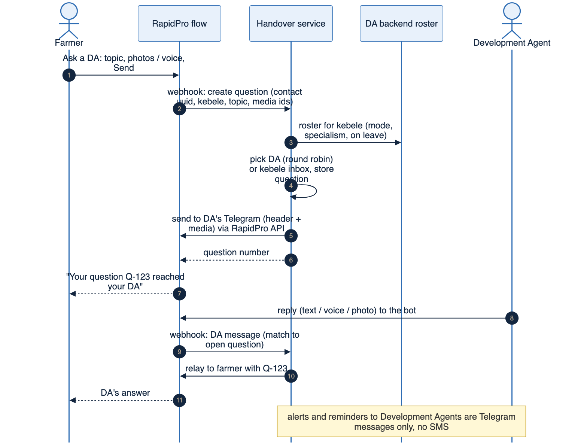
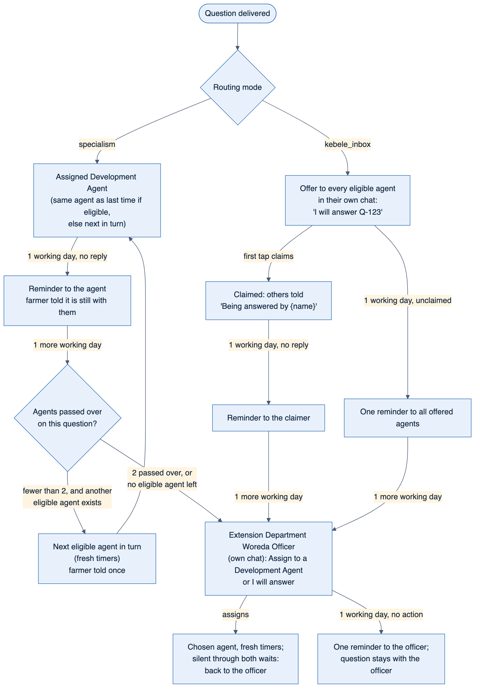
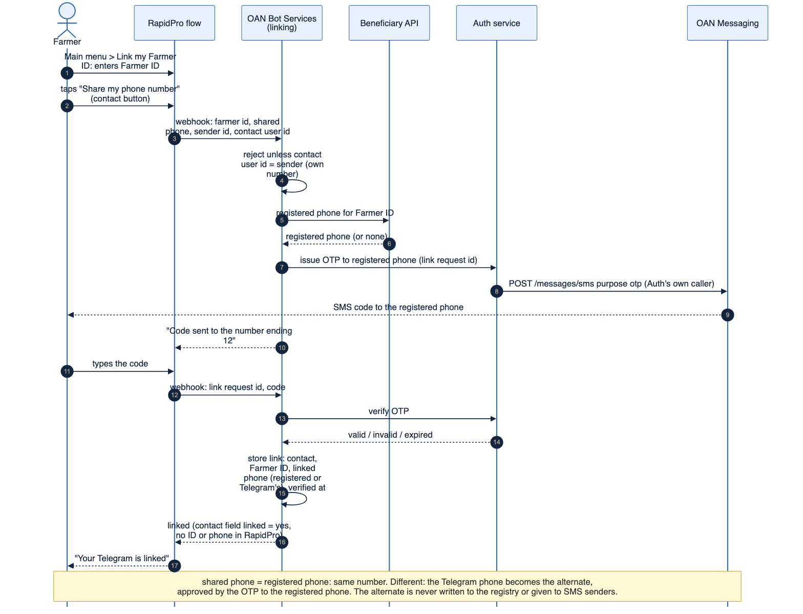

# 6 Telegram channel: modules

## 6.1 MOD-02: Broadcast channels and onboarding

Channel broadcasts need no bot code: DA Communications Officers post to official
read-only Telegram channels. Broadcasts from the DA web app, to the linked farmers or the
Development Agents of a zone, woreda or kebele, go through the bot (§6.8). A bot cannot
send the first message, so a **welcome SMS** and printed materials bring farmers to it.

**Steps**
1. ATI creates one official account that owns the bot and every channel, with two-step
   verification.
2. Create a read-only channel for each area that has a DA Communications Officer
   (region, zone or woreda), named consistently, for example "ATI Oromia Farmer
   Updates".
3. Posting rights go to the DA Communications Officer for each area; the list comes from
   the DA backend roster, and channel admins change when it changes.
4. Generate QR codes and short links for each channel and for the bot. Bot links carry a
   start code: `t.me/<bot>?start=k_<kebele code>` pre-selects the kebele;
   `?start=src_<code>` records where the farmer came from (counted by source only).
5. Development Agents share the links at Farmer Training Centres and kebele meetings.
6. **Welcome SMS.** Every registered farmer with a phone receives one SMS announcing
   OpenAgriNet with the bot link, for example "OpenAgriNet ተጀምሯል። ዝማኔዎችን፣ ዋጋዎችን
   በቴሌግራም ያግኙ፦ t.me/<bot>". It must fit **one SMS part in English and in Amharic**
   (160 GSM-7 characters, or 70 with Amharic); the fuller welcome is shown in the bot.
   The link is the same for everyone (no personal token). It is sent from the DA web
   app's Broadcast screen, woreda by woreda over about two weeks, as SMS purpose
   `broadcast`, so it waits for the SMS-03 fix (§8.2).
7. Main menu has "Official updates", which opens the most local channel for the
   farmer's kebele: woreda, else zone, else region.

**On `/start`:** language, privacy notice, then **"Link your Farmer ID"** with Link now /
Later (§6.6). Link now: the OTP steps, after which the kebele comes from the registry.
Later, or no registry kebele: location menus (with a `k_` code, "Is your kebele X?" with
Yes / Choose another kebele). Linked farmers receive their area's broadcasts unless they
turn updates off in Main menu (§6.8); farmers who chose Later are offered linking again
from Main menu and when a broadcast would have reached them.

**Acceptance:** the welcome SMS fits one part in English and in Amharic; a kebele QR code
reaches Main menu with that kebele set, after the notice and Later, in two taps; only the area's Communications Officer can post; Official updates
opens the most local existing channel.

## 6.2 MOD-01: Market prices

A farmer reaches today's price for one commodity at nearby markets in three taps, served
from the Marketplace backend (prices from NMIS).

**Steps**
1. The Marketplace team publishes the price API; the adapter follows it. Until then,
   build against a stub shaped like the table below.
2. Commodity menu: the 8 most-requested commodities first, then More (cached 24 hours).
3. Market menu: markets in the farmer's woreda first, then neighbouring woredas; or
   "Share my location" to sort by distance (used for the sort, not stored).
4. Price card with Another market, Another crop and Main menu. Compare: up to 5 markets
   for one commodity in one message.

| Call | Request | Response fields |
|---|---|---|
| List commodities | language | `commodity_id`, `name_am`, `name_en`, `unit` |
| List markets | woreda code, or latitude and longitude | `market_id`, `name_am`, `name_en`, `woreda_code` |
| Latest price | `commodity_id`, `market_id`(s) | `market_id`, `price_etb`, `unit`, `price_date`, `source` |

**Rules:** always show the price date; hide prices older than the age agreed with ATI
("There is no recent price for this market"); cache each price 15 minutes, never past its
source date; no personal data goes to the Marketplace backend.

**Acceptance:** three taps from Main menu; date on every card; Marketplace down gives the
fallback message within 6 seconds and Main menu still works.

## 6.3 MOD-03 and MOD-04: Development Agent handover and pest escalation

The farmer sends a question with photos or a voice note; OAN Bot Services passes it to a
Development Agent for the farmer's kebele and relays the reply. Pest and disease cases
go on from the Development Agent to the Crop Subject Matter Specialist, outside the
system.

**Steps**
0. Coverage check when the farmer opens "Ask a Development Agent" (§6.4.1). If the
   kebele is not covered, the farmer sees the "coming soon" message and no question is
   taken.
1. Topic menu: Crops, Livestock, Pests and diseases, Seed and fertilizer, Soil, water
   and forests, Other (mapped to specialisations in §6.4.2).
2. Intake: "Send your question as a voice note, photos or text. Tap Done when finished."
   Up to 5 items within 10 minutes; other file types refused politely.
3. Confirm: show who receives it ("the Development Agent for Kebele X") with Send and
   Cancel; remind the farmer not to send ID numbers.
4. OAN Bot Services reads the roster again and chooses the receiver under the kebele's
   routing mode (§6.4). If no one is eligible, the farmer is told kindly and offered Main
   menu.
5. It creates the question record, delivers it to the Development Agent's chat with the
   bot (a header with the question number, kebele, topic and the farmer's name under
   RP-D4: registered name and Farmer ID if linked, otherwise the Telegram first name
   marked "not verified"; media as attachments), and
   acknowledges: "Your question has reached your Development Agent. Your question number
   is {handover_no}. You will get a reply here."
6. The Development Agent's reply (text, voice note or photo) is relayed to the farmer with
   the question number. Development Agents reply in the same bot. A reply goes to the
   agent's only open question; an agent with several open questions first picks the
   question number from a reply keyboard.
7. MOD-04: the Development Agent taps "Sent to Crop Specialist"; the farmer is told once:
   "Your Development Agent has asked a Crop Subject Matter Specialist to look at your
   photos." One reminder to the Development Agent if no reply by the region's reminder
   time.
8. Reminders, reassignment and the Woreda Officer follow the no-answer chain (§6.4.3).
   All alerts and reminders are Telegram messages; there is no SMS alert.

**Delivery port:** one interface, two implementations. Phase 1 builds Option A
(Development Agent's Telegram). Option B (DA app inbox, media in Garage with short-lived
links) follows when the DA backend inbox is ready.

**Question lifecycle**

| Status | Set when | Next |
|---|---|---|
| `created` | Farmer taps Send | `delivered`, or `unavailable` |
| `delivered` | Sent to the assigned agent, or offered in kebele-inbox mode | `claimed` (inbox only), `replied`, `with_officer` |
| `claimed` | "I will answer" in kebele-inbox mode | `replied`, `with_officer` |
| `with_officer` | The no-answer chain reached the woreda's Supervisors (§6.4.3) | `delivered` (an officer assigns an agent), `replied`, `closed` |
| `waiting` | Nobody at woreda level can take it (§6.4.3) | `with_officer` when a Supervisor or cover becomes eligible; `closed` |
| `replied` | First reply relayed | stays `replied`; or `escalated`, `visit_planned`, `closed` |
| `escalated` | "Sent to Crop Specialist" | `replied`, `closed` |
| `visit_planned` | "Visit planned" | `replied`, `closed` |
| `closed` | The farmer taps "Thank you, that answers it"; the agent or officer taps "Mark as answered"; **2 working days after the last reply with no follow-up** (configurable); or the farmer stops | none; a new message starts a new question, sent first to the agent who answered (§6.4.2) |
| `unavailable` | No one could receive it | none (farmer told kindly) |

Each reply reaches the farmer with **"Thank you, that answers it"** and **"I have a
follow-up"**. Thank you closes the question at once. A follow-up while the question is open
goes to **whoever holds it now** (the agent who replied, or the agent or officer it was
passed to) under the same number, and restarts the no-answer waits. With no response the
question closes 2 working days after the last reply. When closed, the farmer is told
"Question {handover_no} is now closed. Send a new question any time." The weekly report
counts a question as answered when the first reply is sent, not when it closes.

**Question store** (OAN Bot Services PostgreSQL; message content and media are never
stored there; routing additions in §6.4.6)

| Table | Columns |
|---|---|
| `handovers` | `handover_id` (UUID), `handover_no`, `contact_ref`, `kebele_code`, `topic`, `language`, `routing_mode`, `assigned_da_ref`, `answered_da_ref`, `status`, `close_reason`, `created_at`, `delivered_at`, `claimed_at`, `first_reply_at`, `escalated_at`, `closed_at` |
| `handover_messages` | `id`, `handover_id`, `direction`, farmer and agent message references, `da_chat_ref`, `created_at` |
| `routing_state` | `kebele_code`, `specialism`, `last_da_ref`, `updated_at` |

A daily job deletes closed questions 90 days after closing (default). Migrations run as a
Helm pre-upgrade job.

## 6.4 Kebele routing

How a farmer's question reaches a Development Agent in the farmer's kebele, what happens
when nobody answers, and what the bot needs from the DA backend. Grievance routing is
out of scope (parked; the same roster and officer chain are candidates for it later).

### 6.4.1 Which kebele, and is it covered?

**Routing key.** Every question is routed on a Master Data **kebele code**, never a name.
The bot holds no list of farmers per Development Agent.

| Farmer | Kebele used |
|---|---|
| Not linked | The kebele chosen in the bot (location menus or a `k_` QR code) |
| Linked (§6.6), registry returns a kebele code equal to the chosen one | That kebele |
| Linked, registry kebele code differs from the chosen one | The bot asks once: "Your registration says Kebele X. Send your questions there, or to Kebele Y?" and routes on the answer, remembered until the farmer changes kebele |
| Linked, registry returns no kebele code | The chosen kebele (the gap is logged for the registry team) |

The beneficiary API must return the Master Data kebele code, not only a name: kebele
names are not unique (2,675 seeded kebeles share a name with another).

**Coverage check** when the farmer opens "Ask a Development Agent": read the kebele's
roster (R1, cached). The kebele is **covered** when at least one Development Agent is
eligible.

* **Eligible Development Agent:** listed for the kebele in R1, status `active`, Telegram
  linked, not marked unavailable in the bot (§6.4.7), and not already passed over on
  this question.
* If the kebele has Development Agents but every one is unavailable, the kebele still
  counts as covered and new questions go straight to the Woreda Officer (§6.4.3).
* **Not covered:** the menu item still shows. Tapping it shows "The Development Agent
  service is coming soon to Kebele {kebele}. Meanwhile you can see market prices and
  official channels." with Market prices, Channels and Main menu. No question is taken.
* **Covered:** topic, intake and confirm as in §6.3. The roster is read again just
  before delivery, so transfers since the menu opened are respected.

### 6.4.2 Routing modes

Set per kebele by an administrator in the DA backend (D5).

| Mode | How the receiver is chosen |
|---|---|
| `specialism` (default) | Map the topic to an ordered list of specialisation codes (table below). **(a) Same Development Agent first:** the agent who last *answered* this farmer (same `contact_ref`, kebele and topic, within the retention period) gets it if eligible; the turn pointer does not move. **(b)** Otherwise the next eligible agent in turn for the first code in the list that has one (pointer per kebele and code); a kebele may have several agents with the same specialisation (the Dev DA Registry already does), and they take turns. **(c)** If no code in the list has one, the next eligible agent in turn across the kebele. |
| `kebele_inbox` | **Private-chat inbox.** The question is offered to every eligible Development Agent of the kebele, each in their own chat with the bot, with a reply-keyboard button "I will answer Q-123". The first tap claims it; the others are sent "Q-123 is being answered by {name}." No Telegram groups are used. |

**Topic to specialisation** (codes from the DA registry list `DA_SPECIALISATION`; the
mapping is Bot Services configuration, changed without a release):

| Topic | Specialisation codes, in order |
|---|---|
| Crops | `CROP_PRODUCTION`, `AGRONOMY`, `HORTICULTURE` |
| Pests and diseases | `CROP_PRODUCTION`, `AGRONOMY` |
| Seed and fertilizer | `AGRONOMY`, `CROP_PRODUCTION` |
| Livestock | `LIVESTOCK` |
| Soil, water and forests | `NATURAL_RESOURCES` |
| Other | any |

* Follow-ups to an open question go to whoever holds it now, also after it has been passed
  on; the question closes on "Thank you", on "Mark as answered" or 2 working days after the
  last reply (§6.3).
* An agent who is transferred, made inactive or unlinks while holding a question counts
  as passed over. The bot finds this when it next reads the roster: before every
  delivery and timer step, and in a **sweep every 8 hours** of the kebeles that have
  open questions. Their unanswered questions then move under the same rule (within 8
  hours). The DA backend publishes no change events for postings, so the sweep stays. A reply from the old holder before the sweep is
  still relayed.
* An agent who marks themselves unavailable (§6.4.7) is handled at the start of the
  window.

### 6.4.3 When nobody answers

A question is never left with a silent Development Agent. The **Extension Department
Woreda Officer** is the end of the chain. In the DA app this is the **Supervisor** role
with a woreda scope (D6), taken from DA app roles, not from the registry's `position`
or `reports_to`. A woreda may have **several Supervisors**: an escalation is offered to
every linked, available one, each in their own chat; the first "I will answer" or
"Assign to a Development Agent" claims it and the others are told it is taken. An
unavailable Supervisor is replaced by the Development Agents they named (§6.4.7).

**Waits are counted in working time:** one wait is **one working day** (9 working hours),
working hours Monday to Friday 08:30–17:30 East Africa Time, excluding public holidays
from a configured calendar. Hours, days and calendars are configurable per region. A
question sent outside working hours starts its wait at the next working hour.

| Situation | After | The bot |
|---|---|---|
| Specialism mode: assigned agent has not replied | 1 working day | Reminds the agent once; tells the farmer the question is still with their Development Agent |
| Still no reply | 1 more working day | Marks the agent as passed over and tells them "Question {no} has been passed to a colleague."; assigns the next eligible agent in turn; tells the farmer once: "Your question {no} has been passed to another Development Agent, who will reply here." |
| **2 agents passed over**, or no eligible agent left | Immediately | Offers the question to every eligible Supervisor of the woreda (or their cover) with **Assign to a Development Agent** and **I will answer**; tells the farmer: "Your question {no} has been passed to the Extension Department Woreda Officer, who will make sure it is answered." |
| Nobody at woreda level can take it (no linked Supervisor, all unavailable with no cover) | Immediately | Status `waiting`; tells the farmer once that it may take longer than usual and that they can also visit their kebele office; every 8-hour sweep tries the woreda again; shown in the weekly report. No escalation above the woreda |
| Inbox mode: nobody has tapped "I will answer" | 1 working day | One reminder to every offered agent |
| Still unclaimed | 1 more working day | To the Woreda Officer, as above |
| Inbox mode: claimed, but the claimer has not replied | 1 working day after the claim | Reminds the claimer once |
| Still no reply | 1 more working day | Releases the claim (the claimer counts as passed over) and sends the question to the Woreda Officer |
| Offered to Supervisors, nobody has claimed it | 1 working day | One reminder to every offered Supervisor or cover; then it stays offered and counts as unanswered |
| Claimed by an officer who has not acted | 1 working day | Reminds that officer once; the question stays with them |

**Rules**
* A reply at any step ends the chain.
* **Assign to a Development Agent** shows the kebele's eligible agents by display name
  (from R1) on a reply keyboard. The chosen agent gets the question with fresh timers; if
  they stay silent through both waits, it returns to the officer.
* A reply from a passed-over agent is **not relayed**; they are told "This question has
  moved to a colleague." This prevents two answers.
* "Same Development Agent" (§6.4.2) means the one who answered, never one who was passed
  over.
* Every move is recorded (who held it, from when, why it moved) for the weekly report
  and audit.

### 6.4.4 Weekly report of unanswered questions (Reports Central)

The weekly summary is an **executive report, emailed through Reports Central** (the OAN
Report Center, category **DA**). It is not a Telegram message.

* **Snapshot.** Every **Friday at 16:00 East Africa Time** (configurable), Bot Services
  freezes the week's figures into `weekly_da_summary` (counts per kebele, no farmer
  data). The emailed report and the on-screen report show the same numbers, and past
  weeks stay comparable after the 90-day purge.
* **Data source.** Bot Services is an upstream chart service for Reports Central
  (`UPSTREAM_DA_BASE_URL`): `GET /api/v1/charts/{key}?level=woreda|zone|region&code=…&week=YYYY-Www`.
  Charts: unanswered by kebele, by woreda and by zone (count, working days the oldest
  waited, question numbers at woreda level); questions now with the officer; Development
  Agents unavailable and officers covered during the week.
* **Unanswered** = no reply from a Development Agent or officer one working day after the
  question was sent. It includes questions now with the Woreda Officer, questions
  `waiting` with nobody at woreda level (their own heading) and questions closed as
  unavailable during the week. A question counts as answered when the first reply is
  sent.

| Recipient (DA app role and scope) | Rows | Each row shows |
|---|---|---|
| Supervisor with a woreda scope (Woreda Officer) | One per kebele in the woreda | Unanswered count, working days the oldest has waited, question numbers |
| Executive with a zone scope | One per woreda in the zone | Unanswered count, working days the oldest has waited |
| Executive with only a region scope | One per zone, then per woreda | Unanswered count, working days the oldest has waited |

* Never included: farmer names, chat ids, phone numbers or message content.
* A week with nothing unanswered shows one line: "No unanswered questions this week".
* Reports Central schedules the report, resolves recipients and their scopes from DA RBAC
  Assignment and sends the email. Its current specification lists scheduled email and
  role-scoped delivery as out of scope, so these are dependencies on that team (ID-08).
  If Reports Central is not ready when Ask a Development Agent goes live, the emailed report waits:
  snapshots keep accumulating and past weeks can be sent later. Bot Services sends no
  interim email.

### 6.4.5 What the DA backend must provide

The **DA backend** (`oan_da_app_services`) owns every fact routing depends on and is the
bot's only source for them; it takes the agents' details from the **DA Registry**
(OpenG2P, register `DA`) and keeps the postings the registry cannot hold yet.
OAN Bot Services only reads them, caches them and reports dead links. Until every route
exists, the bot is built and tested against a stub with exactly these fields.

| # | Data | Requirement |
|---|---|---|
| D1 | Development Agent ↔ kebele posting | DA backend `DA Kebele Assignment`, state `Effective`: one posting in force per agent, on a Master Data kebele code (for example `ET01010805`). Created from the registry's `kebele_code` when the agent's account is made; transfers and postings by hand are kept here, because the registry has no API for them yet. The same rows decide Development Agent broadcast recipients in the DA backend. |
| D2 | Specialisation | DA Registry `specialisation`, read through the DA backend; required for positions `DEVELOPMENT_AGENT` and `SENIOR_DA`, from `DA_SPECIALISATION`: `CROP_PRODUCTION`, `LIVESTOCK`, `NATURAL_RESOURCES`, `AGRONOMY`, `HORTICULTURE`, `OTHER`. Codes, not display labels. |
| D3 | Status | An active Development Agent grant in the DA backend (`DA RBAC Assignment`, within its effective dates). Agents without one are not eligible. |
| D4 | Telegram link | The linked chat against the person's ref; one active link per person; a new link replaces the old one |
| D5 | Routing mode per kebele | `specialism` (default) or `kebele_inbox`, set by an administrator |
| D6 | Extension Department Woreda Officer | The DA app role **Supervisor** with a woreda scope (`DA RBAC Assignment`, with effective dates), with their Telegram link |
| D7 | Executives above the woreda | The DA app role **Executive** with a zone scope, or with only a region scope; used as report recipients (§6.4.4) |

| # | Route (behind APISIX; bot service account scoped to these only) | In → out |
|---|---|---|
| R1 | Roster for kebele | DA backend route: one or more kebele codes → per kebele the routing mode (D5) and its agents with an `Effective` posting and an active Development Agent grant: `da_ref` (registry DA-ID), display name, specialisation and Telegram linked yes/no (D4). Same rule the DA backend uses for broadcast recipients. Unknown kebele → empty roster, not an error. |
| R2 | Link a person | one-time code + chat → ref, role (`development_agent`, `supervisor`, `executive`) and confirmed; or invalid / expired. Each code works once. |
| R3 | Report unreachable chat | ref + reason (blocked the bot, chat deleted) → link marked inactive until the person links again |
| R4 | Officers for area | woreda, zone or region code → Supervisor or Executive: ref, role, display name, linked yes/no, delivery address |

Checked 19 Nov 2026 against `oan_da_app_services` (`develop`, `2ae3d13`) and the
Development DA Registry: D1–D3 exist in the DA backend (postings and role grants); D6
and D7 exist as DA app roles; **D4, D5 and routes R1–R4 do not exist yet** (ID-03). The
bot does not call the registry. The registry's own `telegram_number` (optional, unverified, mostly
empty) and `reports_to` are not used. There is no individual agent–farmer link: every
Development Agent of a kebele serves every farmer in it (KR-18), so `DA Farmer Link` is
not used.

* **Freshness:** R1 and R4 are cached 5 minutes for menus and coverage checks. Deliveries,
  timer steps, broadcasts and the 8-hour sweep (§6.4.2) **bypass the cache** and read
  the DA backend directly, falling back to the cached copy only when it is down. There is no
  bulk copy of the roster. The DA register publishes no change events
  (`outgest_applicable` is off), so the 8-hour sweep stays.
* **Outage:** if the DA backend is down, the last roster is used for up to 24 hours,
  then the kebele is treated as not covered.
* **Privacy:** the bot never sends the DA backend a farmer's chat id, phone number or
  name.

### 6.4.6 Inside OAN Bot Services

Timers and assignment history live in PostgreSQL, so a restart loses no deadline; caches
are only caches.

| Store | Addition |
|---|---|
| Cache | Roster per kebele (R1) and officer per area (R4): 5 minutes fresh; last copy kept 24 hours for outages |
| `handovers` (new columns) | `holder_ref`, `holder_role`, `next_timer_at`, `timer_kind` (`reminder`, `reassign`, `claim_reminder`, `officer_reminder`, `auto_close`), `pass_count`, `routing_kebele_code`, `last_reply_at` |
| `handover_assignments` (new) | `handover_id`, `ref`, `role` (`development_agent`, `officer`, `officer_cover`), `assigned_at`, `reminded_at`, `ended_at`, `end_reason` (`answered`, `passed_over`, `claim_released`, `unavailable`, `transferred`, `unlinked`, `claimed_by_colleague`, `assigned_by_officer`) |
| `handover_offers` (new, inbox mode and officer cover) | `handover_id`, `ref`, `offered_at`, `outcome` (`claimed`, `claimed_by_colleague`, `expired`) |
| `staff_unavailability` (new) | `ref`, `from`, `until`, `set_at`, `cancelled_at` |
| `officer_cover` (new) | `officer_ref`, `woreda_code`, `covering_refs`, `from`, `until` |
| `outbound_queue` (new) | `contact`, `text_key`, `params`, `created_at`, `released_at` (§5.8) |
| `weekly_da_summary` (new) | `week`, `kebele_code`, `woreda_code`, `zone_code`, counts, oldest wait, question numbers (§6.4.4) |
| `working_calendar` (new) | region code, working hours, public holidays; loaded at start from a YAML file in the Helm values, maintained by ATI DevOps from ATI's yearly holiday list |

* **Worker:** one deployment, separate from the API pods, one active replica holding a
  PostgreSQL advisory lock (a second copy stays passive). It runs:
  * the **timer job** once a minute: picks questions whose `next_timer_at` has passed and
    applies §6.4.3; each step is idempotent, so a crash or a second run does no harm;
    `next_timer_at` is computed from the working calendar;
  * the **queue retry** once a minute (§5.8);
  * the **roster sweep** every 8 hours (§6.4.2);
  * the **weekly snapshot** on Friday at 16:00 EAT (§6.4.4);
  * the **retention purge** daily.
* **Lifecycle:** two new statuses, `with_officer` (next: `delivered` when an officer
  assigns an agent, `replied`, or `closed`) and `waiting` (nobody at woreda level; next:
  `with_officer` or `closed`); replied questions auto-close through the `auto_close`
  timer (§6.3). Passing a question between agents is an
  assignment change, not a status change.
* Logs, metrics and audit events use `contact_ref` only; officer and agent refs may
  appear, chat ids never.

### 6.4.7 Availability and officer cover

Development Agents and officers mark their own unavailability in the bot. It is stored in Bot Services
only and nothing is written to the DA backend.

**Development Agents**
* The staff menu has "Set unavailable": from (today, tomorrow or a date), until (return
  date, at most 60 days), confirm; plus "View or cancel" and "I'm back early".
* During the window the agent is not eligible for new questions, inbox offers, "same
  Development Agent first" or Development Agent broadcasts (§6.8).
* Questions the agent holds when the window starts move at once to the next eligible
  agent (`end_reason = unavailable`; this does not count towards the 2 passed over); the
  farmer is told once.
* If every agent of a kebele is unavailable, new questions go straight to the Woreda
  Officer.
* The window ends on the return date; the agent is told "Welcome back, you will receive
  questions again."
* An agent who is away without saying so is handled by the no-answer chain (KR-07).

**Woreda Officers**
* "Set unavailable" adds a step: choose the covering Development Agents from the
  woreda's agents (Master Data kebeles of the woreda → R1 for each; active and linked
  only; pages of 8). At least one is required.
* During the window, questions that reach the end of the chain are **offered to every
  covering agent**, each in their own chat, with "I will take Q-123"; the first tap
  claims it and the others are told. The claimer has the officer's buttons for that
  question (Assign to a Development Agent, I will answer).
* Questions the officer holds when the window starts are offered to the covering agents
  at once.
* Silent cover: one reminder after 1 working day, then it stays (as KR-10). If no
  covering agent is still eligible, the question waits and goes to the officer on the
  return date.
* Moves are recorded with `role = officer_cover` and who named them.

### 6.4.8 Acceptance criteria

Tested against the DA backend stub, with a fake clock and a test working calendar.

* A kebele with no eligible agent shows "coming soon" and takes no question; it becomes
  covered within 5 minutes of an agent linking.
* A linked farmer whose registry kebele differs from the chosen one is asked once, and
  the answer is used for routing.
* Specialism mode: a Livestock question goes to a livestock agent; successive questions
  from different farmers take turns; a kebele with no agent of that specialism takes
  turns across all.
* A farmer's new question goes to the agent who last answered them when eligible, and to
  the next in turn when that agent is unavailable, unlinked or transferred.
* A "Soil, water and forests" question goes to the `NATURAL_RESOURCES` agent; a "Seed and
  fertilizer" question with no `AGRONOMY` agent goes to the `CROP_PRODUCTION` agent.
* An agent who sets themselves unavailable gets no new questions in the window; their
  held questions move at the start without counting as passed over; they get questions
  again after the return date.
* A transferred agent's unanswered questions move at the next 8-hour sweep.
* A transfer made in the DA app (a new `Effective` posting) changes the roster even if
  the DA Registry still shows the old kebele.
* An officer who is unavailable: escalations are offered to all covering agents and the
  first tap claims; with no eligible covering agent the question waits for the officer's
  return date.
* A message queued for a contact who is in a flow is delivered when the flow ends, in
  order, and the working-day wait starts at delivery.
* No reply: reminder after 1 working day; reassignment after 2 with the farmer told once;
  after 2 agents are passed over the question reaches the Woreda Officer; a passed-over
  agent's late reply is not relayed.
* A question sent on Friday at 17:00 is reminded on Monday at 17:00 (a working day later),
  not on Saturday; public holidays are skipped.
* Inbox mode: the first "I will answer" claims it and the others are told; unclaimed after
  1 working day gets one reminder; after 2 it goes to the Woreda Officer. A silent
  claimer is reminded after 1 working day and released to the officer after 2.
* The officer can assign or answer; the officer is reminded once after 1 working day.
* DA backend unavailable: routing continues on the cached roster for 24 hours, then the
  kebele shows "coming soon".
* Weekly snapshot on Friday 16:00: correct counts per kebele, woreda and zone for a seeded
  week; the chart API returns the same figures for that week afterwards; no farmer name,
  chat id or message text in any chart response or log line.
* Restart during a wait: the timer still fires once, at the right time.
* "Thank you, that answers it" closes the question; with no response it closes 2 working
  days after the last reply; a follow-up after the question was passed on reaches the
  current holder.
* A woreda with two linked Supervisors: both are offered the escalation, the first tap
  claims it and the other is told.
* No linked Supervisor and no cover: the question is `waiting`, the farmer is told once,
  the next sweep after a Supervisor links offers it, and it appears in the weekly report.
* Two agents with the same specialisation in one kebele take turns.

## 6.5 Linking Development Agents and officers

1. In the DA app the person opens "Link Telegram"; the DA backend issues a one-time code
   (8 characters, valid 15 minutes, tied to their ref). This covers Development Agents
   and Supervisors (Woreda Officers). Executives receive the weekly report by email
   (§6.4.4) and do not need to link. Communications Officers send from the DA web app
   (§6.8) and do not need to link.
2. The person opens the bot and sends the code; OAN Bot Services calls R2, and the DA
   backend stores the chat as their delivery address.
3. A new phone or account repeats this; the new chat replaces the old. Someone who leaves
   or moves drops out of the roster and their open questions move at the next sweep
   (§6.4.2).
4. After linking, Bot Services adds the contact to the RapidPro group `staff`, so their
   messages go through the staff flow (§5.8).
5. A wrong or expired code is refused kindly; 5 failures in an hour lock linking for that
   chat for an hour (the lockout stays in the bot).
6. A person who blocks the bot or deletes the chat is reported through R3.

**Option B** (later): the DA app inbox, with "Post question" (`handover_id`,
`contact_ref`, kebele, topic, text, media links, language → message id) behind the same
delivery port.

**Acceptance:** a question with 2 photos and a voice note reaches the right agent and the
farmer is acknowledged within 5 seconds; the reply reaches the farmer with the question
number; no phone number or chat id is sent to either side; "Sent to Crop Specialist"
tells the farmer once.

## 6.6 MOD-08: Farmer linking (OTP to the registered phone)

Linking tells the bot which registered farmer it is talking to. It is offered during
onboarding, right after the privacy notice (§6.1), and from Main menu. Menus, prices and
questions work without it; **broadcasts on Telegram (§6.8)** and MOD-06/07 need it. It is
built in the first Telegram release, with broadcasts (§8.1).

**Steps**
1. The farmer chooses Link now at onboarding (or Main menu › Link my Farmer ID) and types
   their Farmer ID.
2. The farmer taps Share my phone number (Telegram's contact button). OAN Bot Services
   accepts it only if the shared contact's user id equals the sender's.
3. OAN Bot Services gets the registered phone and the registered **kebele code** for the
   Farmer ID from the beneficiary API. An unknown ID and a missing phone give the same
   kind message (visit the kebele office).
4. OAN Bot Services asks the Auth service to send an OTP to the **registered** phone.
   Auth sends it through OAN Messaging as its own OTP caller. The bot shows only the last
   two digits of the number.
5. The farmer types the code; OAN Bot Services asks Auth to verify it.
6. On success OAN Bot Services stores the link (contact, Farmer ID, linked phone, a
   fingerprint of the registered phone, registered kebele code, time) and sets only
   `linked = yes` on the RapidPro contact, and creates the subscription row with updates
   on (§6.8.1). If the registered kebele differs from one the farmer chose earlier, the
   bot asks which one to send questions to (§6.4.1); broadcasts always use the registry
   kebele.
   * **Same number:** the Telegram number equals the registered phone.
   * **Alternate number:** the Telegram number differs; the OTP to the registered phone
     approves it. It is used only for Telegram-specific updates, never written to the
     registry, never given to SMS senders and never logged.
7. **Unlink:** Stop, Main menu › Unlink, or a new link from another Telegram account
   removes the old link. If the registered phone changes, the link must be approved
   again.

| Call | Inputs and outputs |
|---|---|
| Beneficiary API: registered phone, kebele and name | Farmer ID → phone, Master Data kebele code and registered name, or not found (new lookup). The name is read again when a question is delivered (RP-D4) and is not stored in Bot Services. |
| Auth: issue linking OTP | Farmer ID, registered phone, link request id → sent, or rate-limited (new service-client route) |
| Auth: verify linking OTP | link request id, code → valid, invalid or expired |

**Acceptance:** the OTP always goes to the registered phone; someone else's contact is
refused; 5 wrong codes in an hour lock linking for an hour; OTP expiry is set by Auth
(at most 30 minutes); the alternate number never reaches the registry, SMS senders or
logs; the bot makes no call to OAN Messaging. The code the farmer types is a message, so
it sits in RapidPro's history under RP-D1 retention; it is single-use and short-lived.

## 6.7 MOD-06 and MOD-07: Verified status checks (deferred)

Do not build in Phase 1; reserve the menu slot and the adapter interface. Verification
is decided (TG-30): linked Farmer ID only.

* Interface: `check_status(reference, farmer_id) -> {status_label, updated_date} | not_verified`.
* The farmer must be linked (§6.6); the check uses the Farmer ID from the link.
* The comparison happens in the Grievance service or A2C backend, never in the bot. A
  failed check returns the same message as an unknown reference; lock out after 3
  failures in an hour.
* Needs new bot-only routes in both backends, behind the APISIX gateway.

## 6.8 Area broadcasts through the bot

The **DA web app** is the design: its Broadcast screen (`oan_da_app_ui`, `/broadcast`,
FR-10) and its Knowledge Base "Send to farmers" (FR-11). Senders write, choose the area,
recipients and channels there; the bot only delivers the Telegram copy, as OAN Messaging
delivers the SMS copy. Nobody uses RapidPro screens to send. Bot Services adds no rule the
app does not have; a change to the app's behaviour is a decision for the DA team and ATI,
not for this specification.

| Sender (role in the DA app) | Recipients | Area |
|---|---|---|
| Communications Officer, OAN Administrator | All farmers | A whole region, zone or woreda |
| Communications Officer, OAN Administrator | All Development Agents | Within their grant (none = national desk) |
| Supervisor or Executive with the DA role | All Development Agents | Their own woreda |
| Development Agent | All Development Agents | Their own kebele |
| Knowledge Base "Send to farmers" | Farmers | One woreda; English or Amharic (not wired yet) |

Farmer broadcasts belong to the Communications Officer (the FSD; checked with the user 20
November 2026). The DA app offered "All farmers" to every sender; the DA broadcast kit
limits it (`integrations/kits/oan_da_app_services/broadcast-channels/`, VALIDATION-REPORT
V-01).

**What a broadcast carries (from the app):** signal source (Knowledge, Emergency, Weather,
Informational), title (3–140 characters), one message, optional evidence files (PDF, JPG
or PNG up to 5 MB each), the channels ticked (In-app, SMS, Telegram) and the app's
`client_op_id`. There is no approval step and no priority field.

**Language.** The message is sent **as written**, in one language, to every recipient,
and the SMS copy is the same text. A text per language (each farmer in their own) is a
later enhancement that needs DA app changes; it is not built in Phase 1.

### 6.8.1 Who receives it

* **Farmers: linked farmers only** (§6.6), on their **registry kebele code**, whose updates
  are on. A farmer who has not linked gets no broadcasts on Telegram; the bot invites them
  to link. Nobody is asked about updates at onboarding: the privacy notice says that
  linked farmers receive official updates for their area, and "Updates on/off" in Main
  menu turns them off and on again.
* Bot Services keeps one subscription row per linked farmer: RapidPro contact UUID,
  `contact_ref`, Farmer ID, registry kebele, woreda and zone codes, language, updates on
  or off. No name, chat id or phone. The row lives as long as the link: Stop, unlinking or
  a deleted Telegram account removes it at once, and 12 months without any activity
  (configurable) removes the row and the link.
* **Development Agents:** the roster (R1) of the kebele, or of every kebele in the woreda or
  zone: active and linked agents, minus the sender, each in their chosen bot language.

### 6.8.2 `POST /broadcasts`

Caller: the DA backend with its Keycloak service account, only when Telegram is ticked.
The contract follows OAN Messaging's (§3.1–3.4) wherever it can, so one client handles
both channels.

| Field | Notes |
|---|---|
| `Idempotency-Key` (header) | The app's `client_op_id`. First request `202`; the same key and body returns the original (`200`); the same key with a different body is `409 idempotency_conflict`. Bindings kept at least 30 days; compared by keyed HMAC fingerprint |
| `recipients` | `farmers` or `das` |
| `scope` | `{level: zone, woreda or kebele, code}` (Master Data codes) |
| `sender_ref`, `sender_role` | The DA web app has already checked the role and area; Bot Services records both in the audit |
| `source` | `Knowledge`, `Emergency`, `Weather` or `Informational` |
| `source_reference` | Names the business event (for example `da_broadcast:BC-2210`); never personal data |
| `title`, `body` | Sent as one Telegram message: title in bold, then the message; `language` when the app sends one (Knowledge Base), recorded for reporting only |
| `evidence` | Optional files, sent after the message as photos or documents through the media route (§5.9) |
| `expires_at` | Optional, RFC 3339 with an offset, at most 7 days ahead, set by the caller and never extended (as for SMS) |

* Response `202`: `broadcast_id`, `recipients`, and `not_on_telegram` (refs of Development
  Agents not linked to the bot).
* `GET /broadcasts/{id}`: counts per status, with OAN Messaging's names: `accepted`,
  `sending`, `sent`, `failed`, `expired`, `unknown`. Telegram gives no delivery receipt,
  so a successful send ends at `sent`; the app's "delivered" count shows `sent`.
* `GET /broadcasts/{id}/telegram-recipients`: the Farmer IDs whose Telegram copy is `sent`,
  for the SMS step below. Available once the broadcast is finished or after
  `sms_fallback_wait` (configuration, default 15 minutes), whichever is first.
* Errors are `application/problem+json` with OAN Messaging's `code` values
  (`unauthenticated`, `forbidden`, `not_found`, `validation_failed` with `errors[{field,
  code}]`, `idempotency_conflict`, `payload_too_large`, `unsupported_media_type`,
  `service_unavailable`). No `429`; unknown fields are rejected; submitted values are
  never echoed.

### 6.8.3 SMS copy: Telegram first

When both channels are ticked, the DA backend sends the Telegram copy first, then the SMS
copy through OAN Messaging to every registered farmer of the area with a phone **except**
the Farmer IDs returned by `telegram-recipients`. The farmers of the area, with their
registered phones, come from the farmer registry's **beneficiary API** by Master Data area
code (`GET /api/v1/farmers?level=&code=`, cursor paging; ID-01 and ID-04, and the kit's
`docs/BENEFICIARY-API-REQUIREMENTS.md`). The SMS copy is the message as written and may take
up to 3 SMS parts (SMS-09); the app warns when it turns multi-part. A farmer whose Telegram copy failed,
expired, is `unknown` or is still pending after `sms_fallback_wait` gets the SMS. This is
the app's own wording: "farmers without connectivity receive it by SMS". Development
Agents in `not_on_telegram` get the SMS copy the same way.

SMS purpose (§3.1): `Emergency` and `Weather` go as `alert`; `Knowledge` and
`Informational` as `broadcast` (SMS-03 revised, §8.2). The DA backend's caller is allowed
both.

### 6.8.4 Delivery

* Batches through the RapidPro broadcasts API, which does not disturb a flow the farmer is
  in (§5.8).
* `Emergency` broadcasts go ahead of other broadcasts, never ahead of conversation
  replies; several running broadcasts of the same kind take turns batch by batch, so a
  zone sent as many woredas makes progress in every woreda.
* Pace: at most `broadcast_max_per_second` (configuration, **default 20**, never above
  Telegram's 30 for the bot), leaving room for conversation replies. The SMS copy is paced
  by OAN Messaging.
* `expires_at` is checked before every send; recipients not reached by then are `expired`
  and get the SMS copy.
* An attempt whose outcome cannot be proven (a timeout after the request left) is
  `unknown` and **never resent**, as in OAN Messaging; it counts as not delivered for the
  SMS copy.
* A farmer who blocked the bot or deleted their account is `failed`, marked so later
  broadcasts skip them, and never retried. Temporary errors (429, network before the
  request left): retried with Telegram's `retry_after` up to 3 times, then `failed`.
* Link previews off for farmers.

**Acceptance:** a broadcast with Telegram ticked reaches the linked farmers (or the
Development Agents) of that zone, woreda or kebele, and nobody else; an unlinked farmer of
the area gets nothing on Telegram; a repeat `Idempotency-Key` sends nothing twice and
returns `200`; `GET /broadcasts/{id}` shows the counts the app's history shows; the SMS
copy skips exactly the farmers in `telegram-recipients` and reaches those whose Telegram
copy failed, expired or stayed pending; an expired broadcast stops sending; an `unknown`
send is never repeated; an Emergency broadcast overtakes a running Informational one;
replies to farmers stay under 5 seconds during a running broadcast; a Development Agent
broadcast skips the sender and returns agents not on Telegram.
