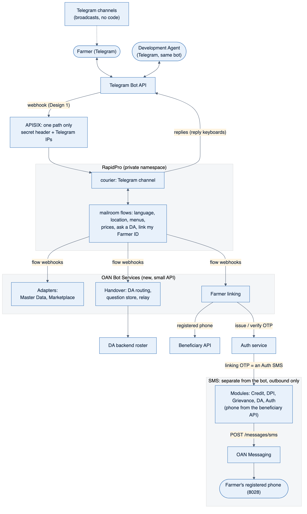
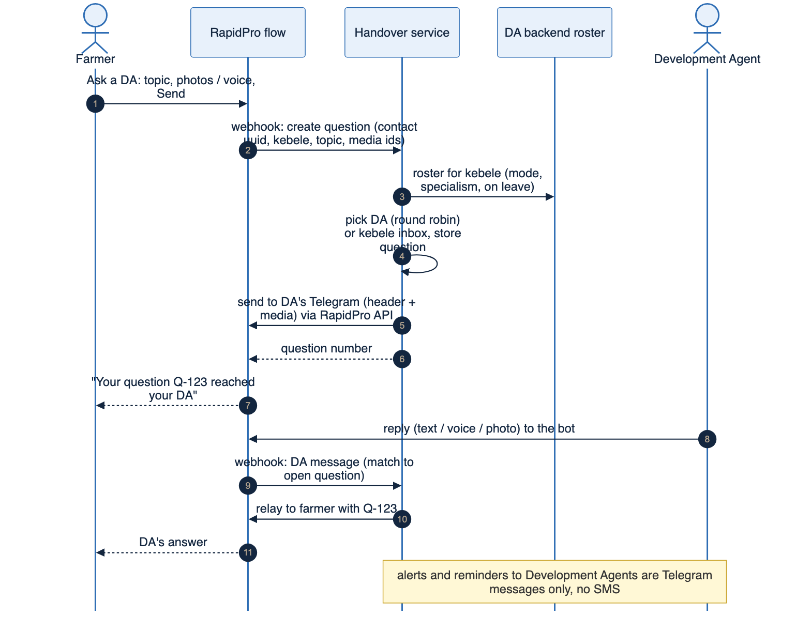
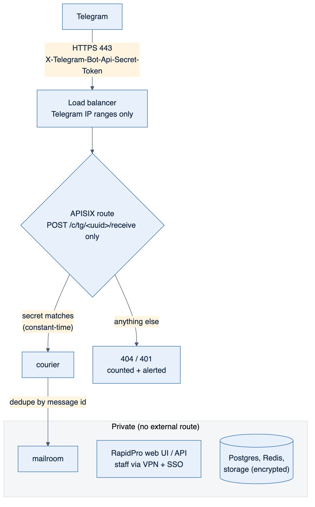
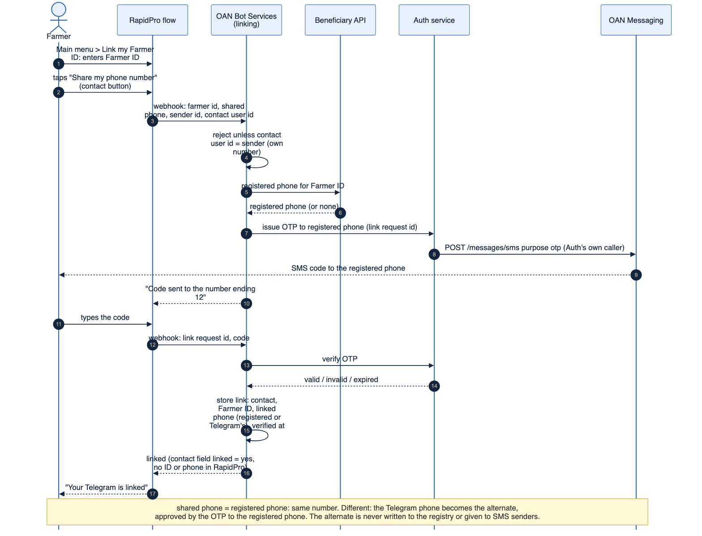

# RapidPro for Telegram routing: evaluation

Version 1.1, 15 November 2026. Status: **Review**.

**Superseded where they differ** by the *OAN Channels Specification* v2.0 (16 November
2026), which folds this evaluation in. In particular, kebele routing (§6.4 of that
specification) uses a private-chat inbox instead of a shared group, and Development Agent
alerts are Telegram only. This evaluation is kept as the evidence behind the RapidPro
decisions.

This evaluates using RapidPro to receive and route the OAN Telegram Bot's conversations.
It was not covered by the *OAN Telegram Bot Developer Specification* v1.0, which borrows
RapidPro *patterns* but builds its own router. Decisions already taken:
* **SMS and Telegram are separate channels.** SMS is outbound only. Each module (Credit,
  DPI, Grievance, Development Agent, Auth) sends it through the OAN Messaging Service to
  the farmer's **registered phone from the beneficiary API**. The Telegram bot sends no
  SMS.
* **Farmers link their Telegram account with an OTP** sent by the Auth service to their
  registered phone. A different Telegram number may be used for Telegram updates once
  that OTP approves it; the registry never changes (§6).
* Development Agent alerts and reminders are **Telegram messages only**.
* RapidPro receives Telegram through a **secured public webhook** ("Design 1").

Version 1.1 of this evaluation replaces 1.0, which had the bot collect farmers' numbers
and send SMS itself.

## 1. Summary

**RapidPro can do the conversation routing, but not all of the bot.** It covers the parts
the spec builds as Module 0:
* receiving updates;
* menus, language and location steps;
* contact state;
* replies within Telegram's limits.

It also lets non-developers edit menus and texts.

It does **not** cover:
* the Development Agent handover rules (round robin by kebele and specialism, kebele inbox
  claim, leave cover, question numbers, reply matching);
* Development Agent linking;
* calls to OAN services, other than as a generic webhook;
* farmer linking (beneficiary API lookup and the Auth OTP).

These need a **small custom service** (called *OAN Bot Services* below) that RapidPro
flows call.

**RapidPro also changes three principles of spec v1.0. Each needs an explicit decision
(§7):**
1. **It stores farmer data.** It keeps a contact per farmer, with the raw Telegram ID and
   name, the full message history and downloaded media. Spec v1.0 holds only a hashed
   contact reference and never stores messages or media.
2. **No inline buttons.** RapidPro sends menus as *reply keyboards*, whose buttons type
   their label as a message. Inline button taps (`callback_query`) are not received at
   all.
3. **A public webhook is required** (secured by Design 1, §5), instead of long polling.

**Recommendation:** adopt RapidPro **plus OAN Bot Services**, as in §4, if ATI accepts the
three changes above. Otherwise keep the custom router from spec v1.0; it is still valid,
and both options link farmers the same way (§6).

## 2. Kinds of routing in the spec, and who does each

| Routing in spec v1.0 | With RapidPro (target) | Covered by RapidPro? |
|---|---|---|
| Receiving updates (long poll, deduplication) | courier Telegram channel via webhook; courier deduplicates incoming messages by Telegram message ID | **Yes**, with Design 1 |
| Conversation state machine (menus, Back, Main menu, language, expiry) | Flows, with split-by-reply, contact language and flow timeouts | **Yes**: rebuilt as flows |
| Location (region › zone › woreda › kebele) | Flow webhook node → OAN Bot Services → Master Data; the kebele stored as a contact field | Partly: flows show the lists; data comes through the service |
| Deep links (`?start=k_<kebele>`, `src_`) | `/start` payload arrives as the first message text; a flow trigger parses it | Likely, but **not verified** on the deployed version |
| Market prices | Flow webhook node → OAN Bot Services → Marketplace API | Partly: the service is still needed |
| **Development Agent selection** (specialism round robin, kebele inbox claim, on-leave skip, reassignment) | **OAN Bot Services**, using the DA backend roster | **No**. A RapidPro ticket's assignee is a fixed user, not an expression, and Development Agents would need RapidPro user accounts. |
| **Relay** farmer ↔ Development Agent with question numbers and follow-ups | OAN Bot Services matches messages to the open question and sends through the RapidPro API | **No**: no forwarding, and no reply-to matching in flows |
| Development Agent Telegram linking (one-time code) | Flow captures the code → service → DA backend | Partly |
| Broadcasts | Official Telegram channels, unchanged (no bot, no RapidPro) | Not needed |
| Outbound queue (two lanes, 429 back-off, blocked user stops contact) | courier and mailroom sending; a blocked user marks the contact stopped | Mostly. Courier's 429 handling and lane priority are **not verified**. |
| **Farmer linking** (Farmer ID, OTP to the registered phone) | Flow collects the Farmer ID and the contact-button share; OAN Bot Services calls the beneficiary API and the Auth service (§6) | Partly: flows collect the input; the checks run in the service |
| SMS | Not part of the bot: modules send to the registered phone through OAN Messaging | Not needed |

## 3. Facts checked in RapidPro's code

| Fact | Source checked | Consequence |
|---|---|---|
| The Telegram channel receives only through an HTTP POST `receive` route | courier `v26.3.82`, `handlers/telegram/handler.go` | A webhook is required; long polling is not supported |
| Courier does **not** check Telegram's `X-Telegram-Bot-Api-Secret-Token` header | same | The gateway must enforce it (Design 1) |
| Quick replies become **reply keyboards**; inline keyboards are URL links only; `callback_query` is not handled | `handler.go`, `keyboard.go` | Buttons are reply-keyboard buttons that send their label as text |
| "Bot was blocked by the user" or "user is deactivated" stops the contact | `handler.go` | Same behaviour as spec v1.0 |
| Incoming messages carry photo, video, audio, voice, document, location and contact | `handler.go` | Media intake works; files are downloaded into RapidPro storage |
| Incoming messages are deduplicated by external (Telegram message) ID | courier changelog | Telegram retries do not create duplicate messages |
| A flow webhook node evaluates header values as templates | goflow `flows/actions/call_webhook.go` (default branch) | A flow can send a per-message `Idempotency-Key` |
| A ticket's assignee is a fixed user reference | goflow `flows/actions/open_ticket.go` | No dynamic round robin in flows |

**Not verified** (deployed RapidPro version unknown):
* whether the web app registers the webhook with a `secret_token`;
* `/start` deep-link handling;
* courier's 429 back-off and reply-before-broadcast priority;
* message and media retention settings;
* RapidPro API rate limits.

## 4. Target architecture

| Component | Owns |
|---|---|
| **RapidPro** (courier, mailroom, web) | Telegram receive (webhook), contacts, flows (language, notice, location, menus, prices, "ask a Development Agent" intake), sending replies, opt-out flow |
| **OAN Bot Services** (new FastAPI service, own Postgres) | Adapters (Master Data, Marketplace, DA backend) behind one Keycloak service account; handover routing (specialism round robin, kebele inbox claim, leave cover); question store (`handovers`, `handover_messages`); relay and reminders (Telegram only); Development Agent linking; farmer linking (beneficiary API lookup, Auth OTP, link store) |
| **Auth service** | Issues and verifies the linking OTP; sends it through OAN Messaging as its own OTP caller |
| **OAN Messaging** | All SMS (8028), one sender, as in the integration handoff. Not called by the bot. |
| **Telegram channels** | Broadcasts by DA Communications Officers (unchanged) |

The flow ↔ service contract is plain JSON over HTTPS with a shared service credential.
Flows never call Master Data, Marketplace, the beneficiary API or Auth directly; the service is the single,
auditable adapter layer, as spec v1.0 requires.

### Development Agent handover with RapidPro

* Development Agents use **the same bot** and are RapidPro contacts in a "Development
  Agents" group. Their messages enter a flow that hands them to the service, which matches
  them to the open question by question number. The spec's "reply to the message"
  matching is not available.
* Status actions ("I will answer", "Sent to Crop Specialist", "Visit planned", "Mark as
  answered") become **reply-keyboard buttons** in the Development Agent's flow.
* **Media:** RapidPro downloads farmer photos and voice notes. The service sends them to
  the Development Agent as attachments (send by RapidPro API with attachment URLs). This
  replaces Telegram forwarding, so Development Agents no longer see the farmer's display
  name. That is a privacy improvement, but a behaviour change.

## 5. Design 1: securing the webhook

| Control | Setting |
|---|---|
| One route only | `POST /c/tg/<channel-uuid>/receive` on a dedicated host; everything else returns 404 |
| Secret header | `setWebhook … secret_token=<64 random chars>`; APISIX checks `X-Telegram-Bot-Api-Secret-Token` in constant time and drops the request on mismatch. This closes the gap that courier itself does not check it. |
| Source IPs | Load balancer or gateway accepts only Telegram's webhook ranges (`149.154.160.0/20`, `91.108.4.0/22`); defence in depth, because the ranges can change |
| TLS | Public certificate, TLS 1.2 or later, port 443 |
| Limits | Body ≤ 1 MB, rate limit per source, short timeout; webhook `max_connections` about 20; `allowed_updates: [message]` |
| Isolation | Courier ingress only from the gateway. Courier egress only to `api.telegram.org:443` and RapidPro's internal services. RapidPro web and API reachable only for staff (VPN plus SSO). Mailroom has no external route. |
| Secrets | Bot token per environment in courier's channel configuration (RapidPro database encrypted, access restricted); webhook secret in a Kubernetes Secret; rotation runbook |
| Monitoring | Gateway counts of rejected calls (alert on spikes); scheduled `getWebhookInfo` (`last_error_message`, `pending_update_count`) |
| Registration | If RapidPro registers the webhook without `secret_token`, DevOps re-registers it with the secret after the channel is added, and checks it after every channel change |

## 6. SMS and farmer linking

### SMS is separate from the bot

* SMS is **outbound only**. Each module that needs it (Credit, DPI, Grievance,
  Development Agent, Auth) is its own OAN Messaging caller and gets the farmer's phone
  from the **beneficiary API**, as in the integration handoff pack.
* The bot and OAN Bot Services **are not OAN Messaging callers** and send no SMS.
* Development Agent alerts and reminders about farmer questions go to the agent in
  **Telegram only**.

### Farmer linking

Linking tells the bot which registered farmer it is talking to. It is optional: menus
and prices work without it.

1. The farmer chooses **Link my Farmer ID** and types their Farmer ID.
2. The farmer taps **Share my phone number** (Telegram's contact button). OAN Bot Services
   accepts it only if the shared contact's user ID equals the sender's, so it is the
   number on the farmer's own Telegram account.
3. OAN Bot Services gets the **registered phone** for the Farmer ID from the beneficiary
   API. If there is none, the bot tells the farmer to update it at the kebele office.
4. OAN Bot Services asks the **Auth service** to send an OTP to the registered phone. Auth
   sends it through OAN Messaging as its own OTP caller. The bot shows only the last two
   digits ("Code sent to the number ending 12").
5. The farmer types the code; OAN Bot Services asks Auth to verify it.
6. On success OAN Bot Services stores the link: contact, Farmer ID, linked phone and time.
   * **Same number:** the Telegram number equals the registered phone.
   * **Alternate number:** the Telegram number differs. The OTP to the registered phone
     approves it. It is used only for Telegram-specific updates, is **never written to
     the registry** and is never given to SMS senders.
7. RapidPro gets only a `linked = yes` contact field: no Farmer ID or phone.

Rules:
* OTP expiry and attempt limits are set by Auth (expiry at most 30 minutes under the OAN
  contract); 5 wrong codes lock linking for that chat for an hour, as for Development
  Agent linking.
* A failed lookup and a wrong Farmer ID give the same message, so the bot never reveals
  whether an ID exists.
* **Unlink:** Stop, a "Unlink" menu item, or a new link from another Telegram account
  removes the old link.
* If the registered phone later changes, the link must be approved again.
* The OTP the farmer types is a message, so it sits in RapidPro's history under RP-D1
  retention; it is single-use and short-lived.

### New work this needs outside the bot

* **Auth service:** OTP routes for linking (issue and verify) for a service client. Today
  its only SMS OTP is for password reset.
* **Beneficiary API:** a phone lookup by Farmer ID for OAN Bot Services. It is the same
  registry-phone decision the Consent Manager OTP flow is waiting for.

## 7. Decisions needed (changes to spec v1.0 principles)

| ID | Decision | Options |
|---|---|---|
| RP-D1 | RapidPro stores contacts (raw Telegram ID, name), message history and media | Accept with an encrypted database, access limited to operators, retention (for example 90 days for messages and media) and a Stop flow that deletes the contact; **or** keep the custom router |
| RP-D2 | Inline buttons are not supported | Accept reply keyboards; **or** patch courier (fork) to send inline buttons and receive `callback_query` |
| RP-D3 | Public webhook | Design 1 (chosen) |
| RP-D4 | Media to Development Agents as attachments instead of forwards | Accept (agents no longer see farmer names); retention as RP-D1 |
| RP-D5 | Farmer linking: OTP from Auth to the registered phone; a different Telegram number allowed as an alternate, approved by that OTP | **Decided**; needs the Auth linking routes and the beneficiary phone lookup |
| RP-D6 | Who runs RapidPro (version, upgrades, backups) | ATI DevOps or the RapidPro platform owner |

## 8. Effort and build order (changes from spec v1.0)

1. RapidPro deployment (or reuse of an existing one), Telegram channel, Design 1 route.
2. OAN Bot Services skeleton: Keycloak client, Postgres, the flow ↔ service contract,
   adapters with stubs.
3. Flows: onboarding (language, notice, location, deep links), Main menu, prices.
4. Handover in the service plus flows for farmer and Development Agent; DA linking.
5. Farmer linking: beneficiary API adapter, Auth linking routes, link store, flow.
6. Hardening: webhook security tests, load test, privacy and retention, Amharic review,
   UAT.

| Spec v1.0 piece | With RapidPro |
|---|---|
| Module 0 receiver, router, state store, outbound queue, message catalogue | **Replaced** by RapidPro (the catalogue becomes flow translations) |
| MOD-01 prices, MOD-03/04 handover, location menus | Flows plus OAN Bot Services |
| MOD-02 channels | Unchanged |
| Postgres question store | Moves into OAN Bot Services |
| Helm chart `oan-telegram-bot` | Becomes `oan-bot-services`, plus the RapidPro deployment |

## 9. Risks

* RapidPro version drift: re-verify §3 on the deployed version.
* Operating RapidPro is a larger platform than the custom bot (web, mailroom, courier,
  Postgres, Redis, storage, search).
* Privacy: RapidPro data stores need retention and access control from day one.
* Reply keyboards are less tidy than inline buttons; usability testing with farmers.
* Two systems to debug (flows and service); the flow ↔ service contract needs contract
  tests.
