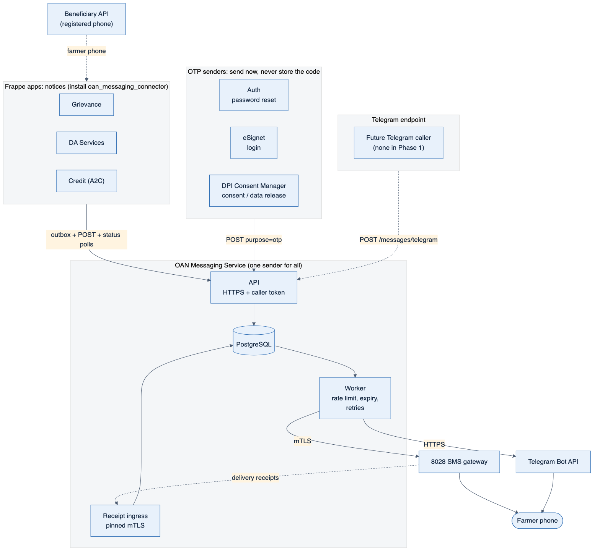
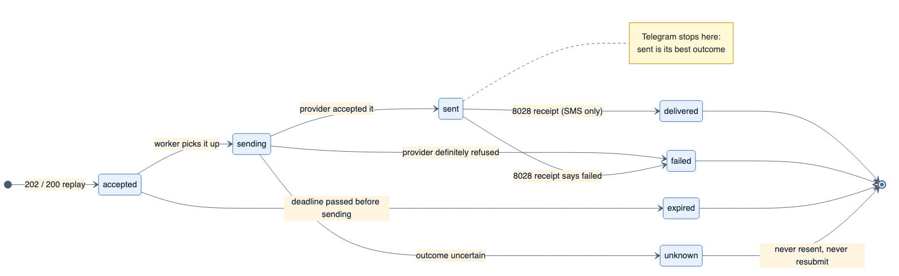

# 01 Architecture

*Source: [diagrams/01-architecture.mmd](diagrams/01-architecture.mmd)*

## 1. One sender for everyone

The **OAN Messaging Service** is the only component that talks to the SMS gateway (8028)
and the Telegram Bot API. Callers never hold provider credentials. They send a request to
OAN and later ask for its status.

| Component | Responsibility |
|---|---|
| **API** (HTTPS) | Authenticates the caller's token; checks purpose, recipient, length and expiry; stores the message durably **before** answering `202`; replays identical requests as `200` |
| **PostgreSQL** | Messages, attempts and receipts. Message text and recipient are purged once a message is past `sending`. |
| **Worker** | Sends due messages under a shared rate limit. OTP is prioritised over other purposes. Never sends after `expires_at`, never resends an uncertain outcome. |
| **Receipt ingress** | Accepts 8028 delivery receipts over mutual TLS (8028's callback CA) with a callback secret; moves SMS to `delivered` or `failed` |
| **Callers** | Decide **what** to send, **to whom**, **when**, and in which language. Keep their own record of each intended message. |

## 2. Three ways to integrate

| Pattern | Who | Why this pattern |
|---|---|---|
| **Frappe connector** (`oan_messaging_connector` app) | Grievance, DA Services, Credit | Notices must survive restarts and outages. The connector gives each message an outbox row with a fixed key, sends it after the business transaction commits, retries safely and polls the status. One app, the same for every Frappe module. |
| **OTP sender** (send now) | Auth, eSignet, Consent Manager | A one-time code must never be stored or logged in plain text, and is worthless after a few minutes. The service sends it immediately with purpose `otp` and the code's own expiry, and keeps only the hash for verification. |
| **Direct API** | Non-Frappe notice senders; a future Telegram caller (none in Phase 1) | Use the OAN client or plain HTTPS. Keep your own record of each message, with its key and OAN id. |

## 3. Status the caller sees

* `202` or `200` means OAN **accepted** the message. It does not mean the message was
  sent.
* `sent` means the provider accepted it. `delivered` (SMS only) means 8028 reported it
  reached the handset. **Telegram stops at `sent`.**
* `unknown` means OAN cannot tell whether the provider received it. **It is never resent,
  and the caller must never resubmit it** under a new key. It needs a person to check.

## 4. Trust and security boundaries

| Boundary | Control |
|---|---|
| Caller → OAN API | HTTPS; one bearer token per calling service, issued by the OAN operator; allowed channels and purposes per caller |
| OAN → 8028 | Mutual TLS with the 8028-issued client certificate |
| 8028 → OAN receipts | Mutual TLS (certificate from 8028's callback CA, optionally pinned) plus the callback secret in each body |
| Data at rest | Message content encrypted; recipient stored as a keyed fingerprint plus a masked form; text purged after sending |
| Logs | Secrets, tokens and message content redacted from every log line |
| Identity | **Delivering an OTP never proves identity.** Only the owning service's verify step does. |

## 5. What OAN does not do

* No status push or webhook: callers poll.
* No batch endpoint and no cancel endpoint.
* Module notices are one SMS part. OAN accepts up to 3 parts only for callers that ask for
  it (DA broadcasts, `max_parts` in the connector).
* Broadcast (`broadcast` purpose) is for DA broadcasts only, switched on per environment.
* OAN sends to 8028 at 4 SMS a second; OTPs always go first.
* It does not choose recipients, templates, languages or business rules. Those stay with
  each module.
