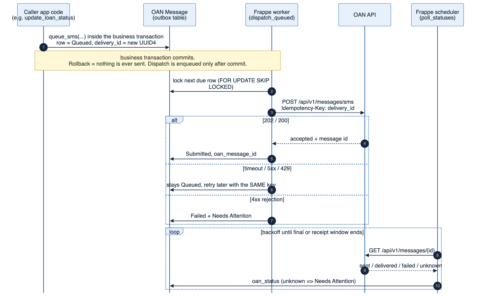
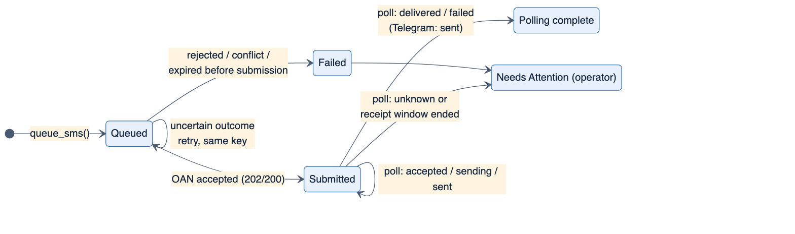

# 03 The Frappe connector (`oan_messaging_connector`)

A reusable Frappe app that every Frappe module installs to send notices through OAN. It
owns everything that is the same for all callers, so each module only adds its texts and
its call sites.

* **Status:** trial build, 41 tests passing; trial-tested end to end with Credit on
  Frappe 16.56.0 and Python 3.14. Meets the checks of the OAN Frappe apps (pre-commit,
  Semgrep with the shared rules, pip-audit; report in `docs/evidence/`). Not released.
  MIT licence, as for other OAN services.
* **Two ways in.** New code calls `queue_sms` explicitly (**preferred**, §5). Modules that
  already send through Frappe's own SMS sender (Grievance and Auth) can instead switch
  that sender to OAN with an opt-in `send_sms` hook (**supported, interim**, §7).
* **Where:** in the developer package, `code/oan_messaging_connector.tar.gz` (source) and
  `code/oan_messaging_connector.bundle` (git history, branch `develop`). Unpack the
  tarball, or `git clone oan_messaging_connector.bundle`, then `bench get-app` the folder.



## 1. What it gives you

| Part | Purpose |
|---|---|
| **OAN Message** doctype | The outbox: one row per intended message. `delivery_id` (UUID4, set at insert) is the Idempotency-Key and never changes. Rows cannot be deleted. |
| **OAN Messaging Settings** (single doctype) | Enabled, base URL, caller token (Password field), CA bundle, HTTP attempts, receipt window, content retention (days); hook purpose and expiry (used only by the `send_sms` hook, §7) |
| `purge_content` | Daily: on finished rows older than the retention period (default 7 days), clears the text and masks the recipient. Delivery metadata stays. |
| `queue_sms(...)` | The call your module makes (preferred) |
| `send_now.send_sms_now(...)` | Sends one SMS at once without the outbox, for OTPs (the Auth kit uses it); errors are the client's, re-exported |
| `sms_hook.send_sms` | Opt-in Frappe `send_sms` hook for modules that already use Frappe's SMS sender (§7) |
| `dispatch_queued` | Runs right after your transaction commits, plus every minute as a safety net. `FOR UPDATE SKIP LOCKED` and one commit per row, so it is safe with several workers. |
| `poll_statuses` | Every minute: GET on rows whose poll is due (backoff 1 min, capped at 6 h). Never resends. |
| One-SMS check | Refuses text that does not fit one part, before calling OAN |

## 2. Outbox row lifecycle (what you see in the Desk)



| Desk status | Meaning |
|---|---|
| **Queued** | Waiting to be handed to OAN, or retrying after an uncertain outcome (same key) |
| **Submitted** | OAN accepted it. **OAN Status** shows progress: `sent`, then `delivered` |
| **Failed** | OAN refused it (validation, conflict, expired before submission). **Needs Attention** is set. |
| **Needs Attention** (flag) | Failed rows, `unknown` outcomes, or polling ended without a final status. A person checks. |

## 3. Install

1. Add the app to the bench and install it on the site:

   ```
   bench get-app <path or repo>/oan_messaging_connector
   bench --site <site> install-app oan_messaging_connector
   ```

2. In your app's `hooks.py`:

   ```python
   required_apps = ["oan_messaging_connector"]   # A2C also lists its own "oan_auth_service"
   ```

3. Make sure the scheduler **and workers** run on the site. Dispatch runs as a
   background job on the **`short`** queue, so a `short` worker is required:
   `bench --site <site> enable-scheduler`, and `bench worker --queue short,default,long`
   (or your supervisor's equivalent).

## 4. Configure (per site)

Either set **OAN Messaging Settings** in the Desk, or use `site_config.json`. Site config
wins, which suits secrets injected by Kubernetes.

```
bench --site <site> set-config oan_messaging_enabled 1
bench --site <site> set-config oan_messaging_base_url https://oan-messaging.<env>.example.invalid
bench --site <site> set-config oan_messaging_token <token from the OAN operator>
bench --site <site> set-config oan_messaging_ca_bundle /path/to/ca.pem   # only for a private CA
```

* The base URL **must be HTTPS**; the client refuses anything else.
* Frappe v16 runs Python 3.14, which **verifies certificates strictly**. A private CA's
  certificates must carry Subject and Authority Key Identifiers (see
  [21](21-environments-and-onboarding.md)).
* While the connector is disabled, `queue_sms` does nothing and returns `None`, and your
  app behaves exactly as before. This is your per-site switch for cut-over and rollback.

## 5. Call it

```python
from oan_messaging_connector.api import queue_sms

name = queue_sms(
    recipient=doc.phone_number,             # 09/07/+251 Ethiopian mobile
    text=rendered_text,                     # already in the recipient's language; one SMS part
    purpose="transactional",                # transactional | alert (OTPs are refused)
    source_reference=f"a2c:{doc.name}:loan_disbursed",
    reference_doctype=doc.doctype,
    reference_name=doc.name,
    event="loan_disbursed",
    language="en",
    expires_at=None,                        # timezone-aware datetime when the message has a deadline
)
```

Rules:
* **Call it inside the business transaction**, at the line of code where the change
  happens: the API function or service method, not a generic `on_update` hook. It only
  inserts a row; sending starts after commit, so a rollback sends nothing.
* **It never raises.** When disabled, when the message is invalid (too long, bad or OTP
  purpose, already expired), or when settings, the database or the queue fail, it
  returns `None` and writes an **Error Log** entry. If only the enqueue fails, it returns
  the row name and the one-minute sweep sends it. Your business action is never blocked
  by an SMS.
* **One call per recipient.** Two people means two calls with the same
  `source_reference`.
* Keep your **texts and event mapping in your own app**. The Credit pattern is a good
  template: `oan_a2c/oan_messaging/events.py` holds the templates, `render()` and the
  event mapping; `notify.py` holds the call sites.

### Things to get right in the call

* **`expires_at` must be timezone-aware.** Frappe datetimes are naive (system time zone).
  Convert first:

  ```python
  from zoneinfo import ZoneInfo
  from frappe.utils import get_datetime, get_system_timezone

  expires_at = get_datetime(visit.visit_at).replace(tzinfo=ZoneInfo(get_system_timezone()))
  ```

* **`language`** is informational (`en`, `am`, later `om`). Render the text in the
  recipient's language yourself; the connector does not translate.
* **Phone format:** the connector removes spaces, dashes, dots and brackets, then checks
  the form OAN accepts (09…, 07…, 2519…, +2519…, 2517…, +2517…) and returns `None` with an
  Error Log for anything else. `send_sms_now` refuses such a number with `ValueError`.
* **Retries:** OAN Messaging Settings › HTTP attempts (default 3) applies per dispatch
  run; the sweep keeps retrying an uncertain row with the same key until it is
  accepted or expires.

### Did it work? (fresh site)

1. Call your code path once with a `0900000xxx` number.
2. An **OAN Message** row appears with status **Queued**, and Error Log has no new entry.
3. Within a minute it becomes **Submitted** with an OAN id.
4. In the local trial stack, the fake gateway inbox (`http://127.0.0.1:18028/inbox`)
   shows the text, and **OAN Status** becomes `delivered`.
5. Disable the connector (`oan_messaging_enabled 0`): your code path still works and no
   row is created.

To show delivery state on your own records, call `messages_for(doctype, name)`; there is
no status-change signal, so read it when the record is displayed.

## 6. Operate

* Desk, **OAN Message** list: filter **Needs Attention**.
* `oan_messaging_connector.api.messages_for(doctype, name)` returns the delivery state of
  one business record, for support screens.
* **OTPs are refused** (`queue_sms` returns `None`): the outbox stores the text, and an OTP
  must never be stored. Use the OTP pattern ([04](04-otp-senders.md)).
* **Retention:** after the retention period, finished rows keep only metadata (status,
  ids, masked recipient, times). Set it in the settings (**Clear Message Text After
  (days)**, default 7) or with `oan_messaging_content_retention_days` in
  `site_config.json`.

## 7. Existing senders: the Frappe `send_sms` hook (supported, not preferred)

Grievance (`_send_sms_row`) and Auth (`_deliver_reset_by_sms`) already send SMS through
Frappe's built-in sender, `frappe.core.doctype.sms_settings.sms_settings._send_sms`.
Frappe lets one app replace that sender with a `send_sms` hook. The connector provides
one, so these modules can move to OAN Messaging **before** they rewrite their send path.

**Prefer explicit calls.** Use the hook only as an interim step for code that already
calls `_send_sms`, and plan the move to explicit calls. New SMS features never use it.

### Why explicit calls are preferred

| | Explicit calls (`queue_sms`, or the OTP job in [04](04-otp-senders.md)) | `send_sms` hook |
|---|---|---|
| Delivery status | Polled into the OAN Message row: `sent`, `delivered`, `failed`, `unknown` | **None.** Success means "accepted by OAN", nothing more. Your record says Sent even if 8028 later reports `failed`, or OAN lets the message expire. |
| Duplicates | One stable key per message; the sweep retries with it until accepted | One random key per call. After the client's own retries (HTTP attempts setting), an unclear outcome raises. If your code then sends again, OAN sees a new message and the farmer may get it twice. |
| OAN unavailable | The row waits in the outbox and is sent when OAN is back | The call fails at once; your record shows Failed |
| Purpose and expiry | Set per message (`transactional`, `alert`, `otp`; your own deadline) | **One purpose and one expiry for the whole site** (settings below), because Frappe passes only the numbers and the text |
| Scope | Only the code you change | **Every** `_send_sms` call on the site, from every app, once any app registers the hook |
| Business link | `reference_doctype`, `reference_name`, `event`, `source_reference` per message | `source_reference` is a random `frappe:send_sms:…` value; the message cannot be traced to your record from OAN |

### Turn it on (per module, explicit opt-in)

Installing the connector registers **nothing**. The module that wants the hook adds one
line to its own `hooks.py` (in its repository, through its normal review):

```python
required_apps = ["oan_auth_service", "oan_messaging_connector"]
send_sms = "oan_messaging_connector.sms_hook.send_sms"
```

Then configure the connector on the site as in §4, plus the two hook settings:

| Setting (Desk) | `site_config.json` | Default | Meaning |
|---|---|---|---|
| Hook Message Purpose | `oan_messaging_hook_purpose` | `transactional` | Purpose of every message sent through the hook. `otp` only on a site where the hook carries nothing but OTPs. |
| Hook Message Expiry (minutes) | `oan_messaging_hook_expiry_minutes` | 30 | OAN drops the message if it cannot be sent in time. At most 30 for `otp`, at most 10,080 (7 days) otherwise. |

The hook uses the site's connector token, so every message counts as the **site's
caller** (for example `grievance`), whichever app called `_send_sms`. The OAN operator
must allow that caller the hook purpose; a caller registered for `transactional` only
refuses `otp`.

Frappe calls the **last** registered `send_sms` hook. Check that no other app on the site
registers one: `bench --site <site> execute frappe.get_hooks --args '["send_sms"]'` must
print only `["oan_messaging_connector.sms_hook.send_sms"]` (it prints nothing when no app
registers a hook).

### What the hook does

* Sends **at once**, inside the caller's request or job, with the OAN client. Nothing is
  stored in the connector, so OTP text is safe.
* One random Idempotency-Key per recipient; unclear outcomes are retried immediately with
  the same key, up to **HTTP Attempts** (settings).
* **Raises `OanSmsNotSent` on every failure:** connector disabled or not configured, text
  empty or longer than one SMS part, OAN refusal, no answer. Messages never contain the
  phone number or the text.
* Writes an **SMS Log** row (when Frappe has that doctype) with masked numbers and no
  text, so code that looks for an SMS Log still finds one.

### Why the hook must raise: Grievance and Auth trust it

Both modules have their own fail-closed check, added because Frappe's sender returns
normally even when it sent nothing (no gateway configured). Both checks are **skipped**
once any `send_sms` hook is registered; the code then trusts the hook:

| Module | Without a hook (today) | With the connector's hook |
|---|---|---|
| Grievance `_send_sms_row` | No gateway URL → row **Failed**. No new SMS Log after the send → row **Failed**. | The hook's exception → row **Failed** (with the error, no phone or text). Accepted → row **Sent** and linked to the masked SMS Log. "Sent" means accepted by OAN. |
| Auth `_sms_gateway_configured()` | No gateway URL → no code is issued; the requester sees the usual silent response | Returns true. The reset job calls the hook; a failure is a failed background job and an Error Log entry. The requester's response is unchanged either way. |

A hook that returned quietly on failure would bring back the bug both checks were written
for ("marked Sent, never left"). The connector's tests run Grievance's delivery logic
with and without the hook, and Auth's gateway check, to hold this in place.

### Auth is on every module site

Grievance, Credit and DA all declare `required_apps = ["oan_auth_service"]`. On a site
with the hook, Auth's password-reset OTPs therefore also go through OAN, with the
**site's** hook purpose and expiry. On a Grievance site that keeps the default
`transactional`, the reset OTP is sent as `transactional` with a 30-minute expiry: it is
still delivered, encrypted and purged after sending, but without OTP priority. Auth's
code still expires after its own TTL. Auth's explicit OTP job ([14](14-auth.md))
removes this compromise.

### Cut-over and rollback

* Cut-over: install and configure the connector, then deploy the module version that adds
  the hook line. From then on, every `_send_sms` on the site goes to OAN.
* Rollback: deploy without the hook line (Frappe's own gateway returns), or disable the
  connector. A disabled connector with the hook still registered makes every SMS **fail
  visibly**. It never falls back to Frappe's gateway.
* Moving on to explicit calls: replace the `_send_sms` calls (Grievance guide
  [12](12-grievance.md), Auth guide [14](14-auth.md)), then remove the hook line.

## 8. Known limits (follow-ups)

| Limit | Plan |
|---|---|
| SMS only | Telegram support can be added the same way when a Frappe module needs it |
| Polling stops at 7 days for SMS (configurable) | Matches the receipt window |
