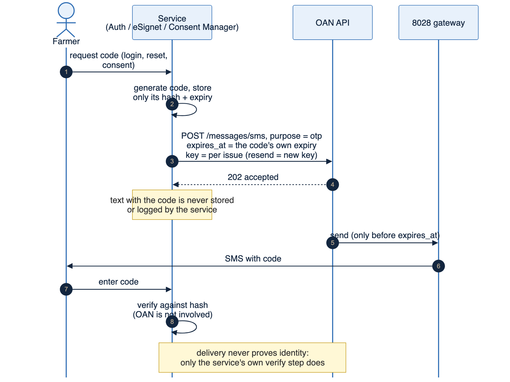

# 04 OTP senders (Auth, eSignet, DPI Consent Manager)

A one-time code is different from a notice:
* it must **never be stored or logged** in plain text;
* it is worthless after a few minutes;
* **delivering it proves nothing about identity.** Only your own verify step does.

So OTP senders **send now** instead of using an outbox.

## 1. Rules

1. **You generate the code** and store only its hash and expiry, exactly as you do today.
   OAN never sees or checks the code except as message text.
2. **Send immediately** with:
   * `purpose = otp`;
   * `expires_at` = **the code's own expiry**, unchanged and at most 30 minutes ahead.
     OAN never sends after it.
3. **Key per issue:**
   * every new code, including a user-requested resend, gets a **new** key;
   * an uncertain POST (timeout, 5xx) is retried with the **same** key and the **same**
     body, so the farmer never gets the same code twice;
   * a resend is a **new code**, not the old text again.
4. **Keep the text out of storage and logs.** Hold it only in memory or in the
   background-job arguments. Mask the code in every log line.
5. **Fail visibly.** If the code cannot be handed to OAN (no phone for the user, refused,
   OAN unavailable after retries), report it to the screen or the caller, and the user
   asks again.
   * Do not store a code nobody received.
   * Do not retry with a new code automatically.
6. **Verification is unchanged** and stays entirely in your service.

## 2. Status after sending

Optional. OTPs are short-lived, so most services do not poll. If you show "code sent",
base it on `202` ("sending your code"), never on delivery.

## 3. Per-service specifics

| Service | Where the code is issued | Key | Guide |
|---|---|---|---|
| DPI Consent Manager | `otp_provider.issue()` (consent and data release) | `delivery_key("dpi-consent", <transaction>, "otp-<kind>-<issue>", "sms")`; `issue` comes from the code's expiry | [11](11-dpi-consent.md) (**built and tested**) |
| Auth | Phone-only password reset (`_deliver_reset_by_sms`) | Random UUID4 created at issue, passed in the post-commit job arguments | [14](14-auth.md) |
| eSignet | eSignet's OTP notification path | `delivery_key("esignet", <transaction_id>, "otp-<sequence>", "sms")` | [15](15-esignet.md) |
