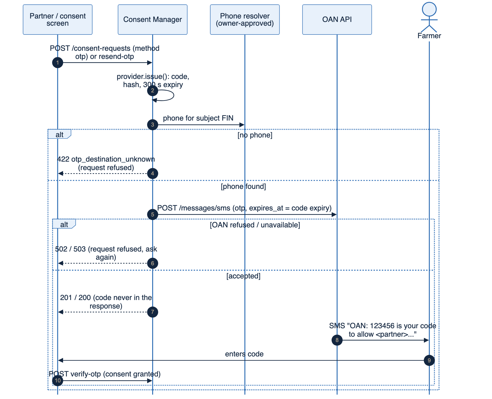

# 11 DPI Consent Manager: consent OTPs by SMS

| | |
|---|---|
| **Pattern** | OTP sender ([04](04-otp-senders.md)); FastAPI service, calls OAN directly |
| **Status** | **Kit built and tested**: lint and Semgrep clean, full backend suite 216 passed (21 new), end to end through OAN over HTTPS |
| **Code** | Kit `code/kits/consent-management/` (one patch on `develop` `32bce76`, with its README) |
| **Today** | On `develop`, OTP consent issues a code but **cannot deliver it**: without a delivering provider, codes go only to the service log or a bucket (test harnesses), and with neither the request is refused (503). Every consent-gated data release (A2C applications, bank partners) is blocked on this. **This is the most urgent gap.** |



## 1. What the farmer receives

| Message | Raised by | Purpose | Text |
|---|---|---|---|
| Consent OTP | `POST /consent-requests` with `method: "otp"`, and `resend-otp` (`otp_consent_service` → `OtpService.issue` → provider) | `otp`, expires with the code (`otp_ttl_sec`, 300 s) | OAN: {code} is your code to allow {partner} to use your registry data. It expires in 5 minutes. Never share this code. |
| Consent granted, denied, revoked, expired; data shared (**phase 2**) | consent services | `transactional` | Templates ready in `examples/dpi_consent_notifications.py`; not wired yet |

When the partner name makes the text too long for one SMS (for example Amharic letters),
a short text without the name is sent instead.

## 2. What the kit changes

`develop` already has the extension point: a provider that delivers sets `delivers`, and
`OtpService` then needs no test harness. The kit uses it.

| File | Change |
|---|---|
| `services/otp_provider.py` | Both providers send the code through OAN when it is configured (`delivers` is then true); otherwise the log and bucket harnesses as before |
| `services/otp_delivery.py` (new) | Purpose `otp`, `expires_at` = the code's expiry, one key per issued code, partner display name, phone from the resolver. On failure raises `OtpError` 422, 502, 503, or 500 for a configuration error. The code and phone are never logged. |
| `services/sms_length.py` (new) | The one-SMS-part rule OAN enforces |
| `config.py` | `oan_delivery_enabled` (default **off**), `oan_base_url`, `oan_token`, `oan_ca_bundle`, `oan_timeout_seconds`, `oan_max_attempts`, `oan_phone_resolver`, `oan_otp_phone_map`; `oan_delivery_ready` |
| `oan_client/` (vendored) | The OAN client, unchanged apart from relative imports |
| `services/otp_service.py`, `services/otp_consent_service.py` | A send whose outcome is uncertain (OAN may still deliver it) still counts against the resend cooldown and the send budgets, so retries during an OAN slowdown cannot flood the farmer; a resend then keeps the new code |
| `backend/tests/` | 14 unit tests and 7 integration tests through the partner portal API |

## 3. Integration steps

| # | Step | Owner | Done when |
|---|---|---|---|
| 1 | Check that the service builds and starts from a clean checkout of `develop` (on `main` it needed a framework pin and `greenlet`; `develop` brings `greenlet` through `sqlalchemy[asyncio]`) | DPI dev | Image builds and starts |
| 2 | Apply the kit (`git am code/kits/consent-management/*.patch`) | DPI dev | `pytest backend/tests` with the test database: 216 pass |
| 3 | **Phone for OTPs.** The Consent Manager stores no phone, only the subject ID. The agreed direction is the farmer's **registered phone from the beneficiary API**. Implement `resolve_phone()` against that route once the identity owner publishes it (the route, its access, and what to do when there is no phone), and remove the dev phone map. | **Identity owner** and DPI | Route published; resolver implemented and tested |
| 4 | Partner display names (at most 30 characters; longer ones are shortened) | DPI | Names checked |
| 5 | Amharic OTP text, which must fit 70 characters with the code and partner name (the kit measures every text and falls back to a short one) | DPI content | Measured |
| 6 | OAN operator registers caller `dpi-consent` (sms; otp, transactional) and issues a token | OAN ops | Token in the secret store |
| 7 | Set `CONSENT_MANAGER_OAN_*` (HTTPS URL, token, CA if private), `..._OAN_DELIVERY_ENABLED=true`; turn `otp_log_codes` and `otp_publish_enabled` off | DevOps | An OTP request produces an SMS |
| 8 | Dev acceptance ([20](20-testing-and-acceptance.md), CM-01 to CM-08) | QA | Evidence recorded |
| 9 | Phase 2: wire the consent notices (granted, denied, revoked, expired, data shared) | DPI | Optional for the pilot |

## 4. Responses the partner portal must handle

| API answer on `POST /consent-requests` (`method: "otp"`) or `resend-otp` | Meaning | Screen |
|---|---|---|
| `201` / `200` | Code handed to OAN (the code is never in the response) | "We sent a code to the farmer's phone" |
| `422 otp_destination_unknown` | No phone for this farmer | "No phone number on record": route to support |
| `502 otp_delivery_rejected` | OAN refused the message | "Could not send the code": alert ops |
| `503 otp_delivery_unavailable` | OAN unreachable after retries | "Try again in a moment" |
| `503 otp_unavailable` | No delivery channel configured (for example OAN switched on without a token) | "Could not send the code": alert ops |

A request whose first code cannot be delivered is cancelled; the partner raises a new one.

## 5. Evidence (17 November 2026)

* Ruff (E, F, W, I, UP, B, RUF, S, BLE) and ruff format on the new files, Semgrep's Python
  correctness and security rules on every changed file: clean. The repository has no lint
  configuration of its own.
* Full backend suite (PostgreSQL 16, Python 3.12): 216 passed with the kit, 195 without;
  the 7 integration tests raise and resend real OTP consent requests, grant the consent
  with the code taken from the SMS, check the 422 and 503 refusals, and check that an
  uncertain resend still holds the cooldown.
* End to end against OAN over HTTPS and the fake 8028, with the same delivery module on
  the `main` build (the only Consent Manager image available): the OTP SMS reached the
  gateway; a wrong code was rejected and the right code approved; a re-issue sent a new
  SMS with a new key and the stale code was rejected; unknown phone 422 with no SMS; no
  OTP code in the service log.

## 6. Configuration example (dev)

```
CONSENT_MANAGER_OAN_DELIVERY_ENABLED=true
CONSENT_MANAGER_OAN_BASE_URL=https://oan-messaging.dev.example.invalid
CONSENT_MANAGER_OAN_TOKEN=<from the OAN operator; secret>
CONSENT_MANAGER_OAN_CA_BUNDLE=/etc/oan/ca.pem          # only for a private CA
CONSENT_MANAGER_OAN_PHONE_RESOLVER=map                 # dev only, until step 3 is done
CONSENT_MANAGER_OAN_OTP_PHONE_MAP={"<test FIN>": "0900000601"}
```

## 7. Farmer registry API and VeriFayda

Both repositories contain no code yet. When they are built:
* **verification codes** (FaydaPass, VeriFayda): reuse this OTP pattern and the same
  delivery module;
* **e-voucher issued, redeemed or expiring:** use transactional notices with the
  voucher's deadline as `expires_at`.

Each needs its own OAN caller.
