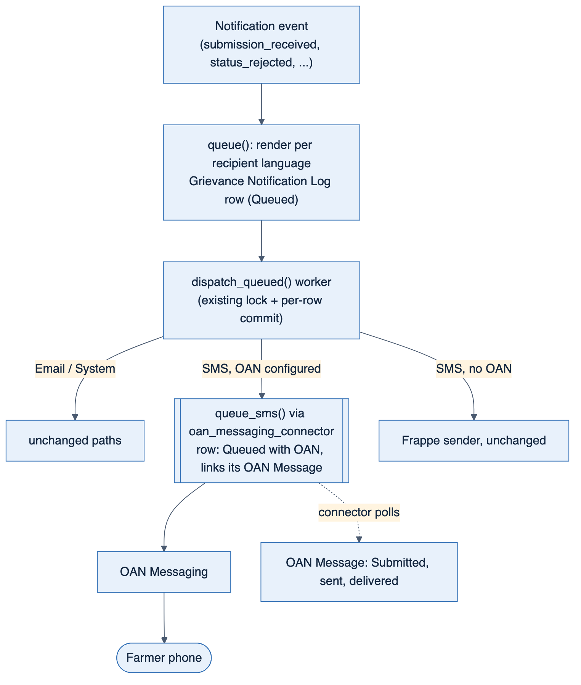

# 12 Grievance: farmer notices

| | |
|---|---|
| **Pattern** | Frappe connector ([03](03-frappe-connector.md)): explicit `queue_sms` calls (**preferred**, §3). Interim option before the kit is merged: the connector's `send_sms` hook (**supported**, §6). |
| **Status** | **Kit built and tested**: lint and Semgrep clean, 29 notification tests, full Grievance suite unchanged |
| **Code** | Kit `code/kits/oan_grievance_service/` (one patch on `develop` `5bb42c4`, with its README) |
| **Today** | SMS goes through Frappe core `_send_sms` from `services/notifications.py` (`_send_sms_row`), with no idempotency key, no expiry and no delivery status. Reviewed at `4d03412` and `5bb42c4`. |



## 1. What stays the same

Grievance keeps all of its own logic: Notification records per (event, channel),
eligibility, recipients, language choice, rendering, the dedup rule and the **Grievance
Notification Log**. Email and System Notification are unchanged. **Only the SMS send
step changes.**

## 2. SMS events (12)

`submission_received`, `duplicate_detected`, `status_in_progress`, `grievance_confirmed`,
`auto_closed_no_response`, `grievance_closed`, `status_rejected`, `more_info_requested`,
`anonymity_disclosure_requested`, `deadline_extended`, `structured_response_sent`,
`confirmation_window_open`.

* Purpose `transactional`; no expiry.
* `source_reference = grievance:<grievance_id>:<event>`. Keep the event names exactly,
  including underscores.

## 3. Integration steps

| # | Step | Owner | Done when |
|---|---|---|---|
| 1 | Install `oan_messaging_connector`; add it to `required_apps` | Grievance dev | App installed on every Grievance site |
| 2 | Apply the kit (`git am code/kits/oan_grievance_service/*.patch`). With OAN configured on the site, `_send_sms_row` calls `queue_sms(recipient=…, text=…, purpose="transactional", source_reference=f"grievance:{grievance}:{event}", reference_doctype="Grievance Notification Log", reference_name=row.name, event=row.event, language=row.language)`; without OAN, Frappe's sender as before | Grievance dev | The 29 notification tests pass |
| 3 | Included in the kit: Grievance Notification Log gets the read-only link **OAN Message** and the status **Queued with OAN** (set when `queue_sms` returns a name; **Failed** with the reason when it returns `None`). The linked OAN Message shows Submitted, sent and delivered. | Grievance dev | The Desk never shows "Sent" on hand-over |
| 4 | Key, outcome handling, polling, stop rules | **Covered by the connector** | — |
| 5 | Template inventory. `anonymity_disclosure_requested` (204 characters) must be shortened; 7 of 12 English templates exceed 70, so their Amharic versions will too | Grievance content | Every template in every language fits one SMS with the longest real placeholders |
| 6 | Normalise phones to an accepted form at send time (today they are only stripped) | Grievance dev | A bad number becomes a visible local failure |
| 7 | Cut-over per site using `oan_messaging_enabled`. Drain Queued SMS rows first. Rollback: disable the connector; rows already Submitted stay with OAN (never resend them) | Grievance and DevOps | Runbook written |
| 8 | OAN operator registers caller `grievance` (sms; `transactional`, plus `otp` for Auth's reset codes on this site) and issues a token; set site config | OAN ops, DevOps | Rows reach Submitted |
| 9 | Acceptance: QA cases GR-01 to GR-15 and COMMON cases | QA | Evidence recorded |

## 4. How the kit does it

```python
def _send_sms_row(row, grievance):
    mobile = _deliverable_mobile(row.recipient, grievance)
    if _oan_enabled():  # oan_messaging_connector configured on this site
        return _queue_with_oan(row, mobile, strip_html_tags(row.message))
    ...  # otherwise Frappe's own sender and its fail-closed checks, unchanged


def _queue_with_oan(row, mobile, text):
    name = queue_sms(recipient=mobile, text=text, purpose="transactional",
                     source_reference=f"grievance:{row.grievance}:{row.event}",
                     reference_doctype="Grievance Notification Log", reference_name=row.name,
                     event=row.event, language=row.language)
    if not name:  # e.g. longer than one SMS part; the reason is in the Error Log
        raise ValueError("OAN Messaging did not queue the SMS; see the Error Log for the reason.")
    return {"status": "Queued with OAN", "oan_message": name}
```

`dispatch_queued` stores the returned status and link on the row, or **Failed** with the
error. The ticket form counts **Queued with OAN** as a way the complainant was reached.

**Evidence (17 November 2026):** Grievance pre-commit and Semgrep clean; 29 notification
tests pass (5 new); full suite 1,222 tests with the kit and 1,217 without, and every
failure with the kit also fails without it (PDF export tests on a bench without a PDF
library, and temporary-password tests). End to end on a Grievance site, a real event's SMS
row read **Queued with OAN** and its OAN Message went Submitted, then `delivered`.

## 5. Why explicit calls, not only the hook

Grievance already sends through Frappe's `_send_sms`, so the hook (§6) would move it to
OAN with one line. It is supported, but it is not the target, because Grievance would:

* show **Sent** when OAN has only **accepted** the message, with no `delivered` or
  `failed` afterwards (the hook gets no status back);
* risk a **duplicate SMS** if a failed row is sent again after an unclear outcome (each
  hook call is a new message to OAN);
* mark a row **Failed** whenever OAN is briefly unavailable, instead of waiting in the
  outbox;
* share **one purpose and expiry** with every other `_send_sms` caller on the site,
  including Auth's reset OTPs.

The kit (§3 and §4) removes all four.

## 6. Interim option: the `send_sms` hook

Use it only if the kit cannot ship first. Details, settings and behaviour:
[03 §7](03-frappe-connector.md).

| # | Step | Owner | Done when |
|---|---|---|---|
| H1 | Install and configure the connector on the site (§3 steps 1 and 8) | Grievance dev, DevOps | Connector enabled |
| H2 | Add to `hooks.py`: `required_apps = ["oan_auth_service", "oan_messaging_connector"]` and `send_sms = "oan_messaging_connector.sms_hook.send_sms"` | Grievance dev | `frappe.get_hooks("send_sms")` returns only this method |
| H3 | Leave Hook Message Purpose at `transactional` and expiry at 30 minutes (Auth's reset OTPs on the same site use the same values) | DevOps | Settings checked |
| H4 | Template inventory and phone normalisation (§3 steps 5 and 6) still apply: the hook refuses text longer than one SMS part | Grievance content, dev | Every template fits |
| H5 | Read "Sent" on SMS rows as **accepted by OAN**; a refusal or an unreachable OAN shows **Failed** with the reason | Grievance support | Support note written |
| H6 | Do not re-send a Failed SMS row automatically: an unclear outcome may already have reached OAN | Grievance dev | No automatic resend |
| H7 | Acceptance: QA cases GR-H1 to GR-H4 | QA | Evidence recorded |

`_send_sms_row` needs **no code change** for the hook: with a hook registered it skips
its gateway and SMS Log checks and treats the hook's exception as "not sent". The
connector's tests run this logic (from `develop` `4d03412`) against the hook: accepted,
refused, and connector disabled. Once the kit is merged, remove the hook line: with OAN
configured the kit's explicit path is used and the hook is never reached.

## 7. Decisions Grievance owns

* Shortened template wording.
* Whether any event needs an expiry (none assumed).
* The cut-over date per site.
* Whether to use the `send_sms` hook as an interim step, and the date it is removed.
* Telegram for Grievance: future scope.
