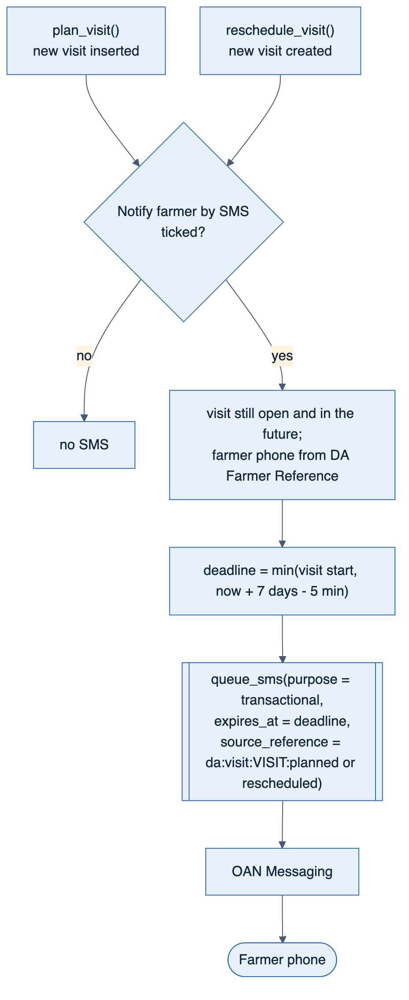

# 13 DA Services: visit planned and rescheduled

| | |
|---|---|
| **Pattern** | Frappe connector ([03](03-frappe-connector.md)), explicit `queue_sms` calls |
| **Status** | **Kit built and tested**: lint and Semgrep clean, 8 tests through the real plan and reschedule services, full DA suite unchanged |
| **Code** | Kit `code/kits/oan_da_app_services/` (one patch on `develop` `ce156bf`, with its README) |
| **Stack** | Frappe app `da_services` (requires `oan_auth_service`) |
| **Today** | There is **no DA SMS sender**. DA Visit already has **Notify farmer by SMS** (`notify_farmer_sms`), set by the Development Agent when planning, but nothing reads it. |



## 1. What is sent

| Event | When | Recipient | Expires |
|---|---|---|---|
| `planned` | `plan_visit` has inserted a new visit with **Notify farmer by SMS** ticked | The farmer | When the visit starts, capped inside the 7-day horizon |
| `rescheduled` | `reschedule_visit` has created the new visit (the old one becomes Rescheduled) | The farmer | Same |

Not an event:
* a visit without **Notify farmer by SMS**;
* an idempotent retry of `plan_visit` (same `client_op_id`): nothing is inserted, nothing
  is sent;
* a visit already started, or no longer Planned or Confirmed;
* a farmer with no phone in **DA Farmer Reference** (logged in the Error Log).

Development Agents get **no SMS**: they are alerted on Telegram (Channels Specification).
A cancellation SMS is future scope unless the DA team defines it.

* Purpose `transactional`.
* `source_reference = da:visit:<visit>:<event>`. A reschedule creates a new visit row, so
  every event has its own reference and no separate event table is needed.
* Texts (English source): "OAN: your Development Agent will visit you on {date} at {time}.
  Visit ref {visit}." and "OAN: your Development Agent visit has moved to {date} at
  {time}. Visit ref {visit}."; each fits one SMS at the longest values.

## 2. Integration steps

| # | Step | Owner | Done when |
|---|---|---|---|
| 1 | Install `oan_messaging_connector` on DA sites (the kit adds it to `required_apps`) | DA dev | Installed |
| 2 | Apply the kit (`git am code/kits/oan_da_app_services/*.patch`): `services/visit_sms.py`, the two call sites in `services/visits.py`, tests | DA dev | `run-tests --app da_services`: the 8 new tests pass, nothing else changes |
| 3 | Farmer phones: the kit reads `DA Farmer Reference.phone` (the cached registry record). Confirm that it is the farmer's registered phone, or switch to the beneficiary API route when it exists (guide 22) | DA and identity owner | Source confirmed |
| 4 | Translations within one SMS part (70 characters with any Amharic character) | DA content | The template test passes |
| 5 | OAN operator registers caller `da` (sms; `transactional`, plus `otp` for Auth's reset codes on this site) and issues a token; site config | OAN ops, DevOps | Rows reach Submitted |
| 6 | Acceptance: QA cases DA-01 to DA-12 | QA | Evidence recorded |

## 3. How the kit does it

```python
def plan_visit(...):
    ...
    doc.insert()
    visit_sms.notify_farmer(doc, "planned")
    return serialize(doc)


def reschedule_visit(name, *, scheduled_at, reason=None):
    doc = frappe.get_doc("DA Visit", name)
    new = doc.reschedule(scheduled_at, reason)
    visit_sms.notify_farmer(new, "rescheduled")
    return serialize(new)
```

`notify_farmer` checks the tick, the status and the start time, computes the deadline
once, reads the farmer's phone and calls `queue_sms`. The connector sends after the
request commits, so a rolled-back plan sends nothing.

**Evidence (17 November 2026):** DA pre-commit and Semgrep clean; the 8 kit tests and DA's
15 visit tests pass; full DA suite 930 tests with the kit and 922 without, no failures.
End to end on a DA site, a planned and then rescheduled visit each reached the farmer's
phone and showed `delivered`.

## 4. Decisions DA owns

* Templates and translations.
* Whether cancellation is a message.
* The cut-over date.

## 5. Broadcasts on SMS and Telegram (added 20 November 2026)

A second DA kit, `integrations/kits/oan_da_app_services/broadcast-channels/`, wires the DA
app's Broadcast screen to SMS and Telegram (spec §6.8, ID-09). It is an add-on Frappe app
installed next to `da_services`, plus one UI patch, and changes nothing in `da_services`:

* All farmers of a region, zone or woreda (Communications Officer and Admin only), and the
  agents of an area as today.
* Telegram first through Bot Services, then the SMS copy through the connector to everyone
  not reached on Telegram. Farmers come from the farmer registry's beneficiary API, whose
  required routes are in the kit's `docs/BENEFICIARY-API-REQUIREMENTS.md`.
* SMS of up to 3 parts (OAN Messaging 3.1.0); purposes `alert` (Emergency, Weather) and
  `broadcast` (Knowledge, Informational). Caller `da` needs both.

Read the kit's `docs/VALIDATION-REPORT.md` first: it lists what the DA code does today
against the spec and which findings the kit fixes.

