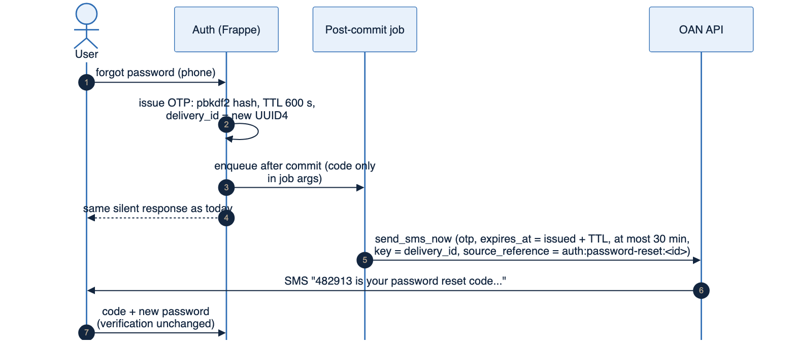

# 14 Auth: password-reset OTP

| | |
|---|---|
| **Pattern** | OTP sender ([04](04-otp-senders.md)), from a Frappe post-commit job (**preferred**, §3). Interim option before the kit is merged: the connector's `send_sms` hook (**supported**, §6). |
| **Status** | **Kit built and tested**: lint and Semgrep clean, 7 tests, full Auth suite unchanged, end to end through OAN |
| **Code** | Kit `code/kits/oan_auth_service/` (one patch on `develop` `34c7306`, with its README); connector `develop` `4ad8507` or later |
| **Today** | `_deliver_reset_by_sms` enqueues Frappe core `_send_sms` after commit. The code lives only in the job arguments (no outbox), which is correct and stays that way. |



## 1. What stays the same

Auth keeps everything except the transport:
* OTP generation and pbkdf2 storage;
* TTL (600 s by default), daily cap and attempt cap;
* verification;
* the template ("{0} is your password reset code. It expires in {1} minutes.");
* the silent response to the requester;
* email reset.

## 2. Why Auth does not use the connector outbox

The connector stores message text on its outbox row. The reset SMS **contains the
code**, and Auth deliberately never stores a code in plain text. So Auth sends from its
own post-commit job, with the text only in the job arguments, and sends with the
connector's `send_sms_now` (no outbox; see §4).

## 3. Integration steps

| # | Step | Owner | Done when |
|---|---|---|---|
| 1 | Apply the kit (`git am code/kits/oan_auth_service/*.patch`) | Auth dev | `run-tests --app oan_auth_service`: the 7 new tests pass, nothing else changes |
| 2 | Install `oan_messaging_connector` (`4ad8507` or later) on the sites where reset codes should go through OAN. Auth does not require it: without it, Frappe's own sender is used as before | DevOps | Connector configured on the site |
| 3 | The site's caller (for example `a2c`, `grievance`, `da`) must allow `otp` as well as `transactional`: Auth sends with that site's token | OAN ops | A reset produces an `otp` message |
| 4 | Recipient format: OAN accepts only Ethiopian mobiles; decide whether to pre-check before issuing | Auth owners | Decision recorded |
| 5 | Acceptance: QA cases AUTH-01 to AUTH-14 | QA | Evidence recorded |

## 4. How the kit does it

`_deliver_reset_by_sms` issues and hashes the code as before. When `reset_sms.oan_ready()`
(the connector is installed and configured), it calls
`reset_sms.enqueue_reset_sms(mobile_no, text, ttl)`, which enqueues one job after commit
with a UUID4 `delivery_id`, an opaque `reset_request_id`, `issued_at` and `expires_at`
(the code's TTL, capped at 30 minutes, OAN's OTP ceiling). The job:

```python
submission = send_sms_now(
    idempotency_key=delivery_id,
    recipient=phone,
    text=text,
    source_reference=f"auth:password-reset:{reset_request_id}",
    purpose="otp",
    expires_at=datetime.fromisoformat(expires_at),
    first_submitted_at=datetime.fromisoformat(issued_at),
)
```

* Accepted: an info log with `reset_request_id` and the OAN id.
* Not configured, refused, or still uncertain after the client's same-key retries: an
  Error Log entry with `reset_request_id` and a reason code. The job is not repeated; the
  user can ask for a new code within the daily cap.
* The code and the phone appear in no log. The requester's response never changes.

**Evidence (17 November 2026):** Auth pre-commit (including gitleaks) and Semgrep clean;
7 kit tests pass; full Auth suite 391 tests with the kit and 384 without, no failures; a
real phone-only reset on the trial bench produced one `otp` message, one SMS at the
gateway and no code in any log.

## 5. Why the explicit job, not only the hook

Auth already enqueues Frappe's `_send_sms`, so the connector's `send_sms` hook would move
the reset OTP to OAN with no Auth change. It is supported, but it is not the target:

* **Purpose and expiry are per site, not per message.** Auth runs on every module site
  (Grievance, Credit and DA list it in `required_apps`). On a site where the hook also
  carries Grievance notices, the purpose must stay `transactional`, so the reset code is
  sent without OTP priority and with the site's expiry instead of the code's own TTL.
* **No retry with the same key across jobs.** The hook retries an unclear outcome only
  inside the one job; it cannot requeue for later.
* **No OAN id in Auth's log**, so a support question cannot be traced to one message.

The kit (§3 and §4) sets `purpose="otp"`, `expires_at` from the code's TTL and a stable
key, and logs the OAN id. With the kit merged and OAN configured, the hook is never
reached for reset codes.

## 6. Interim option: the `send_sms` hook

Details, settings and behaviour: [03 §7](03-frappe-connector.md).

* **No Auth code change.** `_sms_gateway_configured()` returns true once a hook is
  registered, and the reset job calls the hook instead of Frappe's gateway. The code
  stays only in the job arguments; the connector stores nothing.
* **Who registers it.** A `send_sms` line in Auth's own `hooks.py` would turn the hook on
  for **every** site with Auth, including Credit and DA. Register it in the module app
  of the site that wants it (for example Grievance, [12 §6](12-grievance.md)), not in
  Auth.
* **Settings.** On a site where the hook carries only OTPs, set Hook Message Purpose to
  `otp` and the expiry to the code's TTL in minutes (10 for the default 600 s; at most
  30). Otherwise leave `transactional` and 30 minutes.
* **Failures.** When the connector is disabled, not configured, or OAN refuses, the hook
  raises: the job fails with an Error Log entry and no code reaches the user. The
  requester's response does not change, as today.
* Acceptance: QA cases AUTH-H1 and AUTH-H2.

## 7. Telegram linking OTP (new)

The Telegram bot specification v1.1 links a farmer's Telegram account to their Farmer ID
with an OTP to their **registered phone** (from the beneficiary API). Auth issues and
verifies that OTP for the bot's service, using the same OTP sender pattern as the reset:
* `purpose="otp"`, the code's own expiry (at most 30 minutes), a UUID4 key per send;
* `source_reference=f"auth:telegram-link:{link_request_id}"`;
* the code only in the job arguments, stored hashed, never logged.

**Not built.** Open: which Auth site hosts the routes, and the service-client
credentials for the bot's service ([22](22-decisions-and-open-items.md)).

