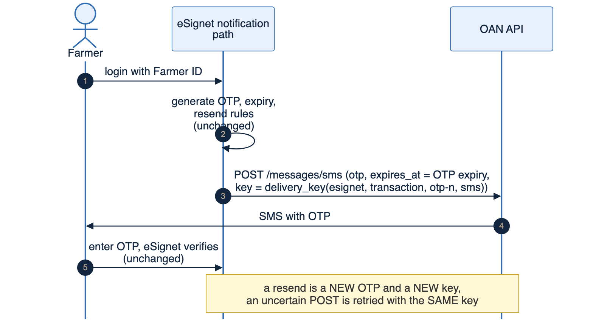

# 15 eSignet: login OTP for Farmer ID

| | |
|---|---|
| **Pattern** | OTP sender ([04](04-otp-senders.md)) over plain HTTPS. eSignet is not Python; the Python example only illustrates the semantics. |
| **Status** | **Sender built and tested**: kit `code/kits/esignet/` (`OanOtpSender`, Java 17+, JDK only; 13 tests; end to end through OAN). **The eSignet team wires it in**; OAN does not edit eSignet. |
| **Note** | No eSignet source was available. Field names marked *assumed* must be confirmed by the eSignet team. |



## 1. Boundaries

* **eSignet owns** OTP generation, the linked-phone lookup, expiry, resend rules and
  verification.
* **OAN only delivers the text it is given.**
* **OAN acceptance or delivery never proves identity.** `delivered` only means the
  operator reported the SMS reached a handset.

## 2. Mapping

| OAN field | eSignet source (*assumed* names) |
|---|---|
| `Idempotency-Key` | `delivery_key("esignet", transaction_id, "otp-<otp_sequence>", "sms")`: a UUID5 over those values (see `examples/oan_client/keys.py` for the exact algorithm), or a stored UUID4 per send |
| `recipient` | The linked phone (`phone_e164`) |
| `text` | eSignet's rendered OTP message; one SMS part |
| `source_reference` | `esignet:otp:<transaction_id>` |
| `purpose` | `otp` |
| `expires_at` | eSignet's OTP expiry, unchanged, at most 30 minutes ahead |

## 3. Integration steps

| # | Step | Owner | Done when |
|---|---|---|---|
| 1 | At the existing delivery point, after the OTP state is stored, call `OanOtpSender.send` (kit `code/kits/esignet/`) instead of the current gateway. **Remove the old gateway call** for these OTPs. | eSignet | One sender only |
| 2 | Keep the key, the exact body and `expires_at` until expiry, for same-key retries | eSignet | Retry test |
| 3 | Retry uncertain outcomes (timeout, 503 or other 5xx, a gateway 429, connection error) with the same key and body; never retry 401, 403, 409, 413, 415 or 422 | eSignet | Tests |
| 4 | A user resend is a new OTP, a new sequence and a new key | eSignet | Test |
| 5 | Keep the OTP text, phone and token out of logs | eSignet | Log review |
| 6 | Check at configuration time that the OTP lifetime is within 30 minutes and the templates fit one SMS | eSignet | Validation |
| 7 | OAN operator registers caller `esignet` (sms, otp); token in eSignet's secret store | OAN ops | Token issued |
| 8 | Acceptance: QA cases ES-01 to ES-13 | QA | Evidence recorded |

## 4. HTTP example (test values only)

```
POST /api/v1/messages/sms HTTP/1.1
Host: oan-messaging.dev.example.invalid
Authorization: Bearer <token>
Content-Type: application/json
Idempotency-Key: 2f1d0c8a-6b3e-5a71-9f2d-0c1b2a3d4e5f

{"recipient":"0900000001","text":"Your OAN code is 482913. It expires in 5 minutes.",
 "source_reference":"esignet:otp:tx-7f3c9a","purpose":"otp",
 "expires_at":"2026-09-01T05:17:13Z"}
```
