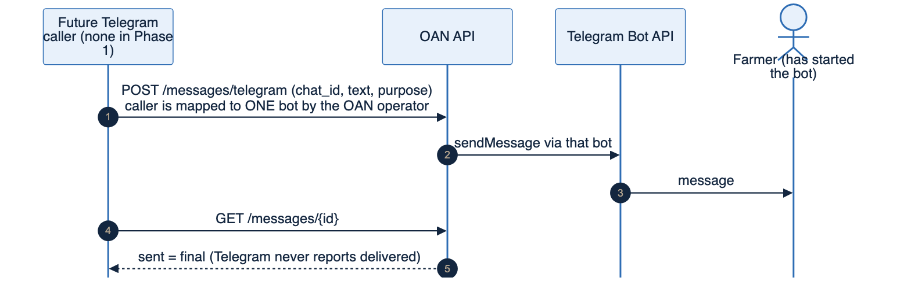

# 16 Telegram

| | |
|---|---|
| **Pattern** | Direct API (`POST /api/v1/messages/telegram`) |
| **Status** | Implemented in OAN (contract 3.2.0). **No caller in Phase 1** (decided 15 November 2026). |
| **Why** | The OAN Telegram bot (bot specification v1.1) runs on RapidPro, which sends to Telegram itself with its own bot token. It is not an OAN Messaging caller, and it sends no SMS. |



## 1. Rules specific to Telegram

* **The farmer must have started the bot first.** A bot cannot message someone who has
  not. The producer owns the link between a farmer and their `chat_id`, and must check it
  is current.
* **One bot per caller.** The OAN operator maps each caller to exactly one bot, and the
  bot token lives only in OAN. A request never carries a token, a URL or markup.
* Plain text only, at most **4096 UTF-16 units**.
* **`sent` is final.** Telegram never reports `delivered`, so do not show "Delivered".
* **No automatic SMS fallback.** If a message must also go by SMS, that is a separate,
  explicit SMS request with its own key.
* The rest of this guide is kept for a **future** caller, for example a module that
  sends notices to farmers who linked their Telegram account. That route is not decided
  ([22](22-decisions-and-open-items.md)). A future caller must not reuse the RapidPro
  bot's token without agreement from the bot's owners: two senders on one bot would
  share Telegram's rate limits and confuse the farmer's chat history.
* Broadcasts stay on official Telegram channels (no code).

## 2. Integration steps

| # | Step | Owner | Done when |
|---|---|---|---|
| 1 | Name the producing service and its owner | Product | **Closed for Phase 1: no producer** |
| 2 | Define the chat-link state (started, blocked, unknown) and how it is refreshed | Producer | Documented |
| 3 | Keep an outbox record per message with a UUID4 key (the same pattern as [03](03-frappe-connector.md)) and poll until `sent` or `failed` | Producer | Tests |
| 4 | OAN operator registers the caller with its bot mapping and issues the token | OAN ops | Done |
| 5 | Acceptance: QA cases TG-01 to TG-16 | QA | Evidence recorded |

## 3. Request example (test values)

```json
{"chat_id": 900000101, "text": "Your grievance G-1042 was updated.",
 "source_reference": "telegram:notice:ge-3", "purpose": "transactional"}
```

If the producer is a Frappe app, the connector can gain a `queue_telegram()` built the
same way as `queue_sms()`. That is a follow-up ([22](22-decisions-and-open-items.md)).
